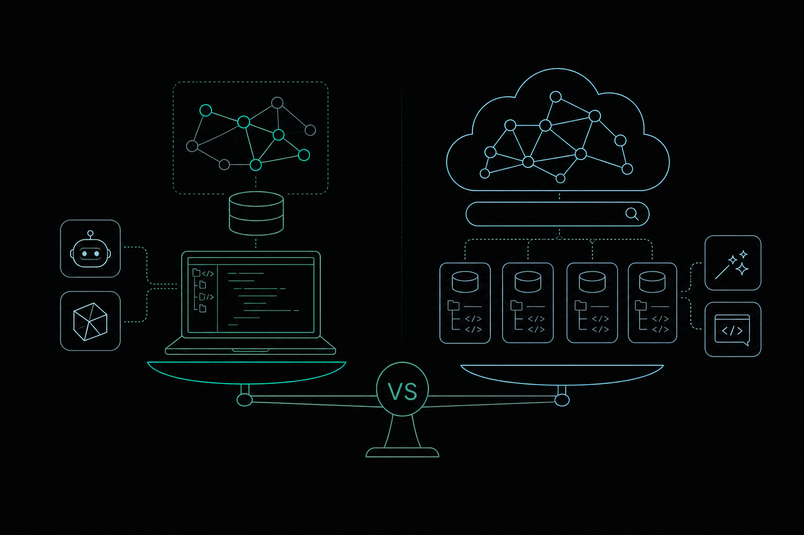

# Code Graph vs. Sourcegraph: A Feature-by-Feature Look

*Updated October 10, 2026*

CodeGraph is a local, MCP-connected code graph that gives AI agents precise structural context within a single repository, reducing token usage and tool calls. Sourcegraph is a centralized platform built for multi-repository search and navigation across large engineering organizations. They target different scales and workflows, so the right choice depends on team size and how you use AI coding agents. This article compares their architecture, agent integration, and language support to help you decide which fits your setup.

## Code Graph vs. Sourcegraph: How They Compare at a Glance

Both tools help agents navigate code, but from opposite directions.

| Tool | Architecture | Primary use case | AI agent integration | Pricing model |
|---|---|---|---|---|
| CodeGraph | Local daemon, pre-indexed graph | Single-repo structural context for AI agents | MCP server, connects to Claude Code, Cursor, and others | Not publicly listed |
| Sourcegraph | Centralized cloud or self-hosted platform | Multi-repo search and navigation across large orgs | Cody AI assistant, Amp agentic coding | Not publicly listed |

## What Is the Architectural Difference Between CodeGraph and Sourcegraph?

CodeGraph runs as a local daemon on your machine, building a pre-indexed knowledge graph from your repository using tree-sitter. It exposes that graph through an MCP server so AI agents can query functions, callers, and definitions without re-reading entire files. The index lives on your filesystem, next to your code.

Sourcegraph takes the opposite approach. It indexes repositories on a central server, cloud or self-hosted, and lets developers search across many repos simultaneously using SCIP-based precise navigation. That architecture suits large engineering organizations where code is spread across dozens of repositories and teams need a shared view. It was not designed to sit inside a single developer's agent loop.

The tradeoff is focus versus scale. CodeGraph goes deep inside one repo. Sourcegraph goes wide across many.

## How Much Can a Code Graph Save in LLM Tokens and Cost?

Token cost compounds fast when agents read large files to answer narrow questions. A pre-indexed graph answers those same questions with a single targeted lookup.

Testing on a production codebase showed that CodeGraph can reduce the tokens used in typical AI agent conversations by 60-70%. Benchmarks across seven repositories using Claude Opus 4.7 indicate that CodeGraph reduces tool calls by 71%. Fewer tool calls mean shorter agent loops and lower API spend.

Sourcegraph's Cody retrieves context from a central index rather than running inside a local agent loop, so the cost model does not map directly to per-token agent runs. For teams paying per-token, the local graph approach produces measurable savings that a centralized search platform does not target.

See the [Memtrace Benchmarks](https://memtrace.io/benchmark) page for structural memory comparisons against search and vector baselines.

## Integration with AI Agents Like Claude Code and Cursor

CodeGraph connects to AI coding agents through MCP. That means Claude Code, Cursor, and any other MCP-compatible agent can query the graph directly during a coding session. Cursor's context is normally scoped to the current session unless an external MCP server extends it, so CodeGraph fills that gap with persistent, repo-wide structural memory.

Sourcegraph offers two agent-oriented products. Cody is a codebase-aware AI assistant that answers questions and generates code using Sourcegraph's central index. Amp is Sourcegraph's newer agentic coding interface, designed for longer, multi-step coding tasks. Both operate through Sourcegraph's own interface rather than plugging into an arbitrary agent via MCP.

If your workflow centers on Claude Code or Cursor and you want the agent to understand blast radius before it edits, CodeGraph's MCP approach fits more naturally. If your team already uses Sourcegraph for search and wants an AI layer on top, Cody or Amp extends what you already have without changing your existing setup.

## Language and Framework Support

CodeGraph uses tree-sitter for parsing, which covers most mainstream languages including Python, TypeScript, JavaScript, Go, and Rust. Frameworks like FastAPI and Django work because tree-sitter parses the underlying Python; the graph captures function definitions, imports, and call relationships regardless of framework conventions.

Sourcegraph supports a similarly broad range of languages through SCIP and its language indexers. Its precise navigation is strongest for languages with mature SCIP indexers. For web frameworks, both tools rely on the quality of their underlying parser or indexer rather than framework-specific logic.

Neither tool requires manual language configuration for common stacks. For less common languages, check each tool's indexer documentation before committing.

## How to Choose: CodeGraph vs. Sourcegraph for Your Team

Two questions decide this: how many repositories do you need to span, and where do AI agents fit in your workflow?

Choose Sourcegraph if your team maintains many repositories across multiple hosts, needs a shared search interface, and uses Cody or Amp as the AI layer. It handles cross-repo navigation at a scale that a local daemon cannot match.

Choose a local code graph if you want AI agents to operate with precise structural context inside a single repository, with lower token costs and no round-trip to a central server. Local code graphs connect functions, callers, APIs, and tests, then expose them to agents via MCP. [Memtrace](https://memtrace.io/) is a local code graph tool that indexes a single repository and serves structural context to AI agents via MCP. The Community tier is free, with paid plans starting at $9/month for higher query limits. Teams needing shared structural memory across multiple developers can use the Teams plan at $29/seat/month with self-hosted MemDB.

The tools are not mutually exclusive. Sourcegraph handles cross-repo search while a local graph handles the deep, single-repo context your agents need before each edit. See [Memtrace for Teams](https://memtrace.io/teams) for how shared structural memory works across a development team.

Prices and plan limits verified as of October 2026.

## FAQs

### What is Sourcegraph Amp and how does it differ from Cody?

Sourcegraph Amp is an agentic coding interface built for longer, multi-step tasks. Cody is a conversational assistant that answers questions and generates code using Sourcegraph's central index. Amp targets autonomous agent workflows; Cody targets interactive, question-and-answer use. Both draw context from Sourcegraph's centralized repository index rather than a local graph.

### What is the difference between Graphify and CodeGraph?

Graphify is a separate tool that also builds a code knowledge graph but extends ingestion to non-code documents. CodeGraph focuses on source code structure: imports, calls, and definitions parsed with tree-sitter. Graphify reached 121,000 GitHub stars within six months of launch, per ai.dosa.dev, which signals broad interest in the knowledge-graph-for-agents category, but the two tools serve different ingestion scopes.

### Does Sourcegraph support single-developer use, or is it built only for large teams?

Sourcegraph's architecture and feature set are designed around large engineering organizations with many repositories. The self-hosted enterprise setup is complex, and the precise search syntax has a learning curve. A single developer working inside one repository will likely find a local code graph a faster fit.

### Can CodeGraph and Sourcegraph be used together in the same workflow?

Yes. CodeGraph handles deep, single-repo structural context for AI agents via MCP, while Sourcegraph handles cross-repo search and navigation. A team could use Sourcegraph to find relevant code across many repositories and then rely on a local code graph to give agents precise context once they are working inside a specific repo. The two tools operate at different layers and do not conflict.

### What happened to Sourcegraph's mid-tier Pro plan?

If you are evaluating Sourcegraph pricing, check the current Sourcegraph pricing page directly for the latest tier structure.

## Conclusion

CodeGraph and Sourcegraph solve related but distinct problems. CodeGraph gives AI agents precise, low-token structural context inside a single repository through a local MCP server. Sourcegraph gives large engineering teams a centralized way to search and navigate code across many repositories, with Cody and Amp as AI layers on top.

If your primary concern is reducing token costs and giving agents accurate context before each edit, start with a local code graph. If you need cross-repo search at organizational scale, Sourcegraph fits. Many teams will find they need both, and the tools can coexist in the same workflow.
