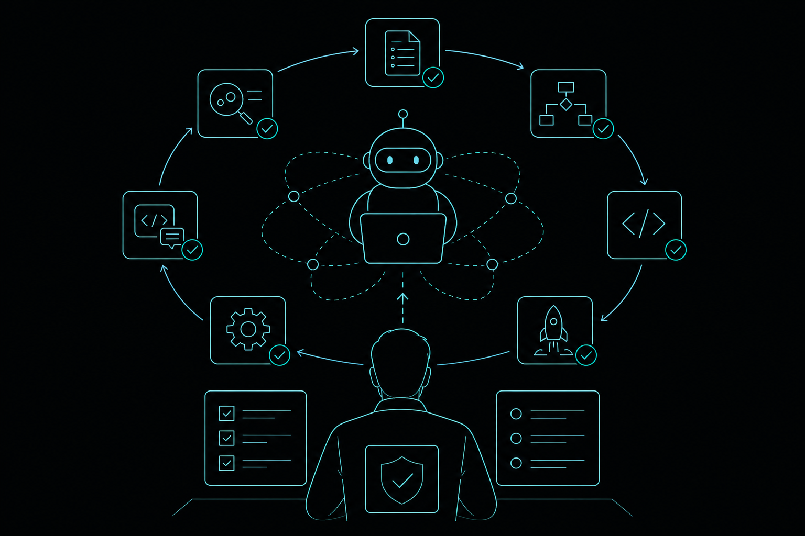

# Agentic SDLC: How AI Agents Fit Each Delivery Stage

An agentic SDLC lets AI agents carry work through requirements, design, test-first coding, review, deployment and maintenance, with humans setting goals and approving gates. Unlike AI-assisted development, where a tool suggests code on request, agents plan and execute multi-step tasks, so each stage needs context, verification and a human checkpoint.

Most teams have moved past autocomplete. Agents now open branches, run tests, and propose pull requests. Adoption is wide, but scaled production success is rare. This guide walks the stages in order and names a gate at each one.

A gate is a check that must pass before work moves to the next stage, and a named person who signs off. You can write each gate down as a short checklist: what the agent produced, what evidence proves it, and who approves. That turns oversight from a habit into a repeatable step.

## What is an agentic SDLC, and is the SDLC outdated?

An agentic SDLC is a software delivery lifecycle in which AI agents plan and execute multi-step tasks across stages, while people own goals, approvals and accountability.

Compare the three models:

1. **Traditional development.** People do every stage by hand, using tools for builds and tests.
2. **AI-assisted development.** A person drives. The tool suggests a line or a function when asked.
3. **Agentic development.** You hand an agent a goal. It breaks the goal into steps, edits files, runs tests, and reports back.

Agentic dev is shorthand for that third mode. The difference is not smarter autocomplete. It is who holds the loop.

SDLC stands for software development life cycle: requirements, design, implementation, testing, deployment and maintenance.

Is it outdated? No. The stages persist because the work they describe persists. What changes is the actor. An agent can draft a design or write a patch, but a person still decides what to build and whether it is safe to ship. Each hand-off between agent and human is now a place to verify.

## How widely are teams adopting AI agents in software delivery?

Scaled deployment is the hard part, even though the numbers on spending and adoption keep climbing.

The global AI-driven SDLC automation market was valued at $4.2 billion in 2025, according to [Research Intelo's 2026 report](https://researchintelo.com/report/ai-driven-software-development-lifecycle-automation-market). Regional survey data points the same direction. A [2026 PwC survey](https://www.pwc.com/m1/en/publications/2026/docs/gen-ai-survey.pdf) of 377 technology leaders and professionals found that 70% of software teams in the Middle East region use generative AI at moderate to high levels in their development lifecycles. That figure covers the Middle East only. Do not read it as a global rate.

The gap shows up between trying agents and running them. One vendor-reported whitepaper from citrusbug.com says 79% of organizations report adopting AI agents, yet only 11% have deployed them at scale in production. Treat that as directional, since a single vendor published it.

Cost is the other pressure. [Jellyfish research](https://jellyfish.co/state-of-ai-software-engineering/) shows median AI cost per user rose 16x over a ten-month period in its 2026 report.

The implication: before rollout, decide who approves each stage gate in the table below and who owns the monthly agent budget. A team that cannot verify agent output or forecast agent spend is likely to stay among the teams that adopt agents without running them at scale.

## How do AI agents fit each delivery stage?

Each stage has an agent task, a human owner and a gate that must pass before work moves on. Use this map to decide where agents start.

| Stage | What the agent does | What the human owns | Gate to pass |
|---|---|---|---|
| Requirements | Gathers and structures needs into functional and technical requirements | Business goals and priorities | A person confirms the requirements match intent |
| Design | Drafts a system blueprint of components and connections | Architecture decisions | Design review before any code |
| Coding | Writes a failing test, then minimal code, then refactors | Acceptance criteria | Failing test existed first; tests not weakened or deleted |
| Review | Checks the change for defects and regressions | Merge decision | Reviewer sees blast radius and callers |
| Deployment | Runs the release steps in a controlled environment | Release approval | Staged rollout with a rollback path |
| Maintenance | Triages bugs and proposes fixes | Priority and sign-off | Fix passes tests before merge |

Read the table left to right. The agent column grows as trust grows. The gate column never shrinks. The sections below take each stage in order, starting with requirements and design.

To make a gate real, write it as a checklist with three lines: the artifact the agent hands over, the evidence that proves it is sound, and the person who approves. For a coding gate, the artifact is a pull request, the evidence is a failing test that predates the code, and the approver is the reviewer who owns the merge. If any line is blank, the work does not move on.

## Step 1 and 2: Use agents for requirements and system design

Start where the lifecycle starts: intent. Agents help you structure it, but you own it.

1. **Identify business needs and project goals.** Have the agent gather functional and technical requirements from tickets, specs and stakeholder notes, then write them up as a structured list. You confirm the business goals. The agent does not decide what the product is for.
2. **Create a system blueprint.** Ask the agent to draft how users interact with the system and how components connect. Treat the output as a proposal. Review it before any code exists.

The gate at this stage is a human read-through. Check that each requirement traces to a stated goal and that the blueprint names every component the change touches.

Design is also where context pays off first. A blueprint drafted without knowing what already exists in your repo invents structure you already have. Give the agent the real shape of the system, then ask for the delta.

Keep requirements and design reviews separate from coding. Errors here cost the most downstream, and an agent will build a flawed blueprint faithfully.

A practical way to run these reviews is to ask three questions in order. Does every requirement trace to a goal someone on your team can name? Does the blueprint list each component the change will touch, including ones the agent did not mention? Is there anything the agent assumed that nobody confirmed? Write the answers down. A short written review is easier to audit later than a verbal nod in a meeting.

## Step 3 to 5: Let agents write code test-first and refactor safely

Test-first is the safest way to hand an agent a coding task. The test defines done before the agent writes a line.

3. **Commit a failing test.** The test reproduces the defect or specifies the new behavior. No production code exists yet.
4. **Develop the minimal production code.** The agent writes only what it needs to make that test pass.
5. **Refactor under test cover.** The agent improves structure while the tests act as a safety net. Behavior does not change.

This fits agile iterations. Agile ships in short cycles, and each cycle is a small slice through requirements, design, code and test. The agent runs this loop inside a sprint. You review at the end of each slice.

The loop still fails when the agent edits blind. A passing test tells you the target behavior works. It does not tell you what else broke.

That is where [Memtrace](https://memtrace.io/) fits. Memtrace is a local code graph tool that connects functions, callers, APIs and tests across one repository for AI coding agents. Your agent queries it over MCP before the next edit, so it sees blast radius, traces execution paths, and recalls why code was written a certain way. The agent starts from structural context, not from zero.

Use that context at step 5 especially. Refactors touch callers, and a graph lookup shows them first.

A simple routine keeps the loop honest. Before the agent edits, have it list the callers and tests that touch the code it plans to change. After the edit, compare that list with the files in the diff. If the diff reaches a file the list did not mention, stop and review that change by hand before merging.

## How do anti-cheat gates work in an agentic SDLC?

The sources describe no formal standard for governing agent work, so treat the loop of act, verify and approve as a working pattern, not a certification. In practice it means the agent acts, a gate verifies, and a person approves.

The core risk is an agent that passes its own checks without solving the problem. It can weaken a test, delete one, or write code that passes only the cases it saw. Anti-cheat gates exist to catch that. They check two things:

1. **A failing test existed first.** The test was committed before the production code.
2. **Tests were not weakened or deleted.** The suite after the change is at least as strict as before.

Emergence Technology's SDLC Automation Engine describes this approach. Per emergencetech.ai, it provides anti-cheat TDD enforcement and multi-lens adversarial code reviews in sealed sandboxes with zero outbound internet connectivity. It also requires a 90-day historical replay validation before production use. The card comes from a single source, so weigh it as one vendor's description.

If you evaluate more than one tool, test each against the same seeded cheats: a deleted assertion, a loosened threshold, a test written after the code. Run the same set against every candidate, record which cheats each gate catches, and require a human to sign off on any change the gate flags.

Gates only work when a person owns the approval. An automated gate narrows what a reviewer must check. It does not replace the reviewer.

To set up your own gate, keep it small. Store the failing test's commit before the production commit, and compare the test suite before and after the change for removed or loosened assertions. Flag any difference for the reviewer. Start with these two checks, then add more only when you see a failure they miss.

## Deployment, maintenance and tooling: what to budget for

Review, deployment and maintenance are where agents run longest, so cost and oversight add up here. Plan both before you scale.

For maintenance, Emergence Technology's engine offers 24/7 bug remediation and reviews code in sandboxes, per emergencetech.ai. For custom work, Fingent builds and deploys autonomous agents, including multi-agent integration across ERP and CRM systems. Both are single-source cards, so verify the claims in a trial. Neither lists public pricing.

Measure before you rely on any platform. Pick one contained task, record how long a person takes and how many defects reach review, then run the agent on the same task and compare the two.

Budget for usage, not seats alone. Spend grows with use, so cap agent runs and review the bill monthly.

For deployment, keep the agent inside a controlled environment and require a staged rollout. Release to a small share of traffic first, watch error rates, and keep a tested rollback path ready before the agent runs the next step. A person approves each widening of the rollout, not the agent.

For maintenance, route agent-proposed fixes through the same gates as new work. A bug fix needs a failing test that reproduces the defect, a passing run after the change, and a reviewer who confirms nothing else moved. Treat a fix without a reproducing test as a guess, however confident the agent sounds.

Maintenance needs memory too. An agent fixing a bug three months after the original change has no idea why the code looks the way it does. Memtrace's code graph lets it recall that history and see callers before the next edit.

Memtrace pricing is public, and it runs from a free Community tier through Pro and Pro+ plans up to per-seat Teams and custom Enterprise plans. Exact tier limits and prices are on the Memtrace pricing page.

## FAQs

### What does SDLC stand for, and is it outdated now that agents write code?

SDLC stands for software development life cycle: requirements, design, implementation, testing, deployment and maintenance. It is not outdated. The stages still describe the work. What changes is who performs each one. Agents take on more tasks, and every hand-off between agent and human becomes a place to verify.

### What is the agile model in SDLC, and does it still apply with agents?

Agile delivers software in short cycles, each a small slice through requirements, design, code and test. It still applies. Agents run the test-first loop inside a sprint, and your team reviews each slice at the end. Short cycles also limit how far a bad agent edit can spread.

### What is agentic dev, and how is it different from using a code assistant?

Agentic dev means you hand an agent a goal and it plans the steps, edits files, runs tests and reports back. A code assistant suggests a line or function when you ask. The difference is who holds the loop: in agentic work, the agent does.

### What does an agentic SDLC cost to run?

Costs are mostly usage-driven, so they grow as your team runs more agent tasks. Specialist vendors list no public pricing, while Memtrace publishes tiers that start free. Budget agent usage first, then tooling.

### Which delivery stage should a team hand to agents first?

Start with test-first coding on a contained, well-tested part of your repo. The failing test defines done, and a gate can check it. Requirements and design carry higher stakes, so keep a person firmly in charge there until you trust the process.

### How do you stop an agent from gaming its own tests?

Add anti-cheat gates. Check that a failing test existed before the production code and that no test was weakened or deleted. Seed cheats such as a deleted assertion or a loosened threshold to confirm the gate catches them, and keep a human approving the merge.

## Conclusion

An agentic SDLC works when each stage has a gate and a person who owns it. Agents carry the multi-step work. Your team keeps the goals, the approvals and the accountability.

Start small. Pick one contained area of your repo, require a failing test first, and check what each agent edit touches before you merge it. Set a monthly agent budget before you widen the rollout.