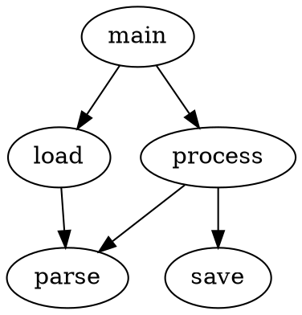

# Call Graph Generator: Free Tools to Map Function Calls

A call graph generator maps which functions call which others in a program, with each function as a node and each call as an edge. PyCG builds static call graphs for Python, and Jelly does the same for JavaScript. Static tools run fast but can miss dynamic calls. Runtime tracing catches those calls, but only on code paths you execute.

## What is a call graph generator and how does it work?

Static generators read code without running it. They resolve calls from syntax and type information, so they cover every path in the files you give them. Dynamic behavior is the weak spot: callbacks, reflection, and runtime-resolved calls can slip past.

Dynamic generators run the program and record calls as they happen. They show what actually executes, but only for the inputs and tests you run. A function that never fires during tracing never appears.

Choose static for broad coverage. Choose dynamic for ground truth on a specific run.

## How to build a call graph step by step

Build a small graph by hand first. It shows what any generator does under the hood.

Take this program:

```python
def main():
    load()
    process()

def load():
    parse()

def process():
    parse()
    save()

def parse(): pass
def save(): pass
```

1. Identify all functions in the program as the nodes of the graph. Here: `main`, `load`, `process`, `parse`, `save`.
2. Draw a directed edge wherever one function invokes another. `main` calls `load` and `process`; `load` calls `parse`; `process` calls `parse` and `save`.
3. Write the edges as DOT text:



4. Paste the DOT into any Graphviz renderer to get an image.

Notice that `parse` has two callers. A call graph surfaces that kind of fact before you change a function.

## Free call graph generator options for Python and JavaScript

For Python, use PyCG, a tool built to generate call graphs for Python programs. In a benchmark study it outperformed large language models at call graph generation, though the benchmark's developers found some errors in its own ground-truth annotations (per arxiv.org). Treat that as one source, not a verdict.

For JavaScript, use Jelly, which builds static call graphs for JavaScript applications. The same study reports it beat advanced LLMs like GPT-4o on completeness and soundness for JavaScript analysis (per arxiv.org).

This comparison has no research-backed Java option, so check current documentation for your Java stack before you commit.

## Static, dynamic or AI-based: which call graph approach fits?

The right approach depends on what you need: coverage, ground truth, or fast setup. Every static analyzer trades soundness (missing no real calls) against precision (reporting no false ones).

| Approach | Strength | Main limitation | Typical output |
|---|---|---|---|
| Static (PyCG for Python) | Covers all code you point it at without running it | Can miss dynamic calls; accuracy depends on the language's dynamism | A call graph for Python programs |
| Static (Jelly for JavaScript) | Complete and sound relative to LLMs on JavaScript in one benchmark | Same dynamic-call blind spots; single-source evidence | Static call graphs for JavaScript apps |
| Dynamic tracing | Records calls that really happen | Only sees paths you execute | A graph of one run |
| AI-based | No parser setup | Trails static tools in the benchmarks above | Varies by prompt |

Output format varies by tool. Confirm what each one emits before you wire it into a pipeline.

## Can LLMs map function calls as accurately as static analyzers?

Not yet, based on the benchmarks. TraceEval, a benchmark for call graph reasoning, comprises 10,583 real-world programs drawn from more than 1,600 repositories (arXiv, 2026). Its existence shows how seriously researchers now measure AI-based call graph reasoning.

In that body of work, PyCG and Jelly beat LLMs on their respective languages. Static analyzers remain the reference for accuracy because they apply deterministic rules to every file. An LLM can guess a plausible edge. A plausible edge is not a verified one.

## When a one-off call graph is not enough: a persistent code graph

A one-off graph goes stale after your next commit. If you need callers, tests, and APIs queryable across a repo, you need a graph that stays current.

[Memtrace](https://memtrace.io/) is a local code graph tool that connects functions, callers, APIs, and tests across one repository for developers who need to query code relationships. It maintains a queryable graph across your repo and updates it as the code changes. It is not a one-click call graph image tool.

Community is free with 1,000 graph queries per month, then 50 per day. Pro costs $9 per month for 5,000 queries with no daily throttle.

Prices and plan limits verified as of November 2026.

## FAQs

### Do I need to run the code to generate a call graph?

No. Static generators like PyCG and Jelly read source code without executing it. Running the code matters only for dynamic tracing, which records calls that happen during a run. Start with static for coverage, then add tracing if you need to confirm runtime behavior.

### What is the difference between a call graph and a control flow graph?

A call graph shows which functions call which other functions across a program. A control flow graph shows the execution paths inside a single function, such as branches and loops. Use a call graph to trace relationships between functions. Use a control flow graph to study logic within one.

### How do I keep a call graph current as the code changes?

Regenerate it on every commit or in CI, or use a tool that updates its graph as the repository changes. A one-off export goes stale after the next merge. A persistent local code graph avoids that by tracking the repo continuously.

## Conclusion

For Python, start with PyCG. For JavaScript, start with Jelly. Both are static, both beat LLMs in the cited benchmarks, and both can miss dynamic calls.

Next, run one on a small module you know well and compare its output to your hand-drawn graph. Any missing edges show you where that tool's blind spots are.