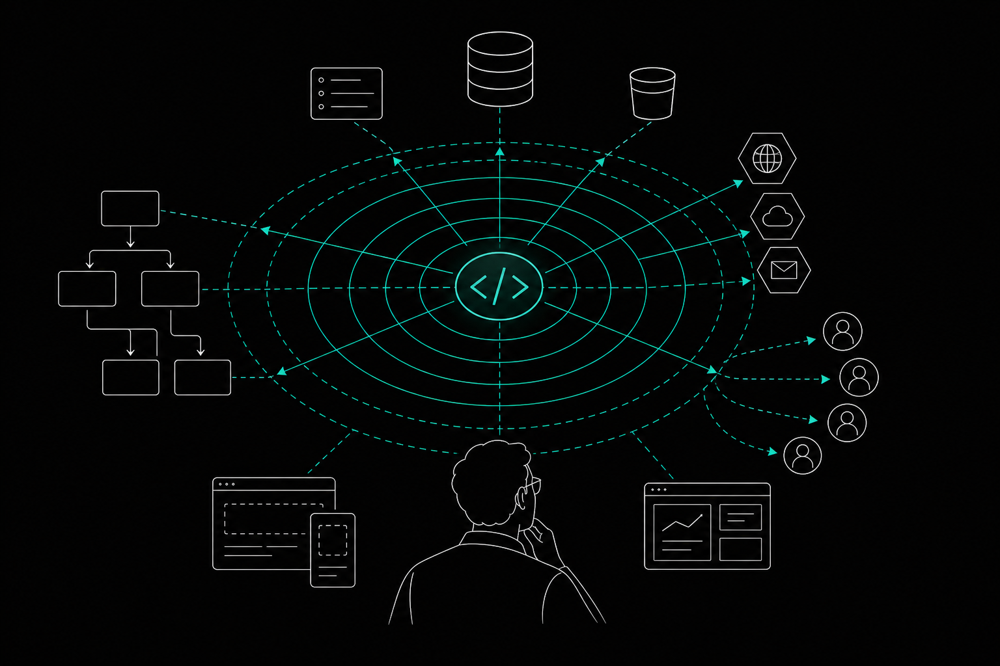

# Code Blast Radius: How to Measure It Safely in 2026

- [What Is Blast Radius in Code?](#what-is-blast-radius-in-code)
- [Why Is AI Widening the Code Blast Radius?](#why-is-ai-widening-the-code-blast-radius)
- [How to Calculate Blast Radius in 4 Steps](#how-to-calculate-blast-radius-in-4-steps)
- [Using a Blast Radius Graph Instead of Text Search](#using-a-blast-radius-graph-instead-of-text-search)
- [A Risk-Based Review Rubric for Tiered Impact](#a-risk-based-review-rubric-for-tiered-impact)
- [How to Contain Blast Radius: Feature Flags, Bulkheads, and Canaries](#how-to-contain-blast-radius-feature-flags-bulkheads-and-canaries)
- [FAQs](#faqs)
  - [What is the blast radius of a 1000 lb bomb, and how does that relate to code?](#what-is-the-blast-radius-of-a-1000-lb-bomb-and-how-does-that-relate-to-code)
  - [What is the difference between code radius and artifact radius?](#what-is-the-difference-between-code-radius-and-artifact-radius)
  - [What does blast radius mean in a data center or cloud environment?](#what-does-blast-radius-mean-in-a-data-center-or-cloud-environment)
  - [Is a small diff always a small blast radius?](#is-a-small-diff-always-a-small-blast-radius)
  - [What do developers on Reddit say about measuring code blast radius?](#what-do-developers-on-reddit-say-about-measuring-code-blast-radius)
  - [Can feature flags and canaries shrink blast radius without changing the code?](#can-feature-flags-and-canaries-shrink-blast-radius-without-changing-the-code)
- [Conclusion](#conclusion)

Code blast radius is the set of callers, shared state, outputs, and users a change can affect, not the size of its diff. Measure it by tracing callers outward until you reach a user-facing feature, noting shared state and external outputs, then ranking the impact of a failure.

A ten-line edit can break checkout. A thousand-line refactor can touch nothing anyone uses. Diff size tells you how much text changed. It does not tell you who depends on that text.

AI-assisted development widens the gap. Agents write changes fast, and nobody has traced those changes before merge. This guide gives you a four-step method to measure code blast radius before you merge.

## What Is Blast Radius in Code?

Blast radius in code is the full area a change can affect if it fails: direct callers, indirect callers, shared state, external outputs, and the users who depend on all of them. The term borrows from physical explosions, where damage depends on what sits near the charge, not on the charge's weight alone.

That definition matters because it separates two things people often confuse. The diff measures what you touched. The blast radius measures what your change can reach.

A rename in a utility function shows the difference. The diff is a few lines, but the function may sit under dozens of callers across several services, each feeding a feature a customer sees. The reverse also holds: a large diff inside a leaf module with no dependents carries little risk.

Size still correlates with risk in aggregate. Research cited by Koalr in 2026 shows pull requests with fewer than 200 changed lines had a 5% incident rate, while those exceeding 500 lines reached 14%. Koalr is a vendor, so read these as one team's findings, not a universal law. Larger changes tend to touch more surface area, so measure that surface directly instead of guessing from line count.

1. **Callers.** Every function, service, or job that invokes the changed code, directly or through a chain.
2. **Shared state.** Database columns, caches, queues, and config that your change writes and others read.
3. **External outputs.** Files, events, and APIs that leave the codebase and feed other systems.
4. **Users.** The features and people at the end of those chains.

Measure all four. A caller count alone misses the column another team reads at midnight.

## Why Is AI Widening the Code Blast Radius?

AI-assisted development widens blast radius because agents produce more changes, faster, with less awareness of what depends on the code they edit. Review capacity does not scale at the same rate. More risk reaches production with less scrutiny.

The 2026 data points the same direction. The Cortex 2026 Engineering in the Age of AI Benchmark found that change failure rates have increased by approximately 30%. A CodeRabbit study found that AI-generated code has 1.7x the issue rate of code written by humans. Neither figure proves AI is the sole cause, but together they describe more changes failing in more places.

Review is where the strain shows. Faros AI telemetry from April 2026, covering 22,000 developers, found that teams with high AI adoption saw median time in review rise by 441.5%. The same dataset found a 31.3% increase in pull requests merged without any review. Both figures come from a vendor, so read them as one dataset's signal.

Put those together. Reviewers face more code and take far longer per change, and some teams skip review entirely. Either way, nobody checks what the change reaches.

An agent that edits a function sees the file in front of it. It does not see the indirect caller three hops away, or the report that reads a column the change now writes differently. That blind spot is blast radius in AI-assisted work: the distance between what the agent can see and what the change can touch.

You close that distance by measuring impact before the edit, not after the incident. The next section shows how.

## How to Calculate Blast Radius in 4 Steps

Calculating blast radius means walking outward from the changed code until you reach users, then ranking what a failure would cost. Work through these four steps before you merge.

1. **Trace the dependency chain.** Start at the function you changed and list its direct callers. Then list the callers of those callers, and keep going until you reach a user-facing feature: an endpoint, a screen, a scheduled job a customer notices. Stop at the feature, not at the first caller. Indirect callers are where most missed breakage hides.

2. **Document shared state.** Note every database column, cache key, queue message, or config value your change modifies that other code reads. A caller trace will not surface these, because the readers never call your function. They read what it leaves behind. Search each column or key by name and record who consumes it.

3. **Identify external outputs.** List everything your change emits that leaves the codebase: files written for another team, events published to a bus, API responses consumed by outside systems. These carry the highest cost per failure because you often cannot see or fix the consumer.

4. **Map to users and rank impact.** Take each feature, state reader, and external consumer you found and tie it to the people or systems behind it. Rank them by what a failure would cost: a broken admin report is not a broken checkout. The ranked list is your blast radius.

Write the result down, even as five lines in the PR description. A recorded trace lets your reviewer check your work instead of redoing it.

Two habits keep the method honest. First, set a stopping rule per step. Without one, a trace through a shared utility never ends. A user-facing feature, or a boundary where the code leaves your repo, is a clean stop. Second, trace by structure, not by name. A string search finds places that mention a function. It misses callers that reach it through an interface, a dynamic dispatch, or a wrapper under a different name.

That gap is not small. In a 2026 Team Banzai demo, a dependency map identified 365 affected code locations that a standard text search for the name failed to find. Team Banzai is a vendor and the figure comes from its own demo, so read it as an illustration, not a benchmark. It shows why step one fails when you rely on grep alone.

## Using a Blast Radius Graph Instead of Text Search

A blast radius graph maps functions, callers, and dependencies as connected nodes, so you can query impact instead of searching for strings. Text search finds where a name appears. A graph finds what actually depends on the code, including callers that never mention it.

Grep breaks down in predictable places. Interfaces hide implementers. Dynamic calls leave no literal name. Wrappers rename what they forward. Each one produces callers your search cannot see, and those callers are the ones that fail in production. The Team Banzai demo above, where a dependency map found 365 locations that a name search missed, shows this gap.

You have three practical options for building the graph.

**Build it by hand.** For a small module, draw the caller chain from the call sites your IDE reports. It works for a few hops and stops scaling past that. You will also forget to redraw it.

**Use a cross-repo tool.** If your risk lives between repositories, Riftmap offers an interactive graph and an "Impact Mode" for visualizing organization-wide dependencies. It runs as a browser extension and focuses on what its sources call artifact radius: shared Docker base images and Terraform modules used across repos. Its pricing is not publicly listed. It answers a different question than a code-level trace, so use it when the dependency crosses a repo boundary.

**Query a local code graph.** [Memtrace](https://memtrace.io/) is a local code graph tool that connects functions, callers, APIs, and tests across one repository for developers and their coding agents. You and your coding agents query it before an edit, so the trace in step one becomes a lookup instead of a manual hunt. It connects to existing coding tools through MCP and keeps the graph current as the repo changes.

Whichever you pick, the test is the same: does it return callers you did not already know about? A graph that only confirms what you expected adds nothing. One that surfaces an indirect dependent three hops out has done its job. Still, treat its output as input to steps two through four, not a replacement: a graph traces calls well, but it does not know that a column feeds a nightly export, so shared state and external outputs still need your attention.

## A Risk-Based Review Rubric for Tiered Impact

Review depth should scale with measured blast radius first and PR size second. A small diff with a wide trace deserves more scrutiny than a large diff inside a leaf module.

Size still gives you a starting signal. Koalr's 2026 data shows a 5% incident rate for pull requests under 200 changed lines and 14% above 500 lines. Both figures come from vendor datasets, so use them to justify a policy, not as fixed laws.

Use the traced result from the four steps to pick a tier:

| Tier | Measured blast radius | Typical PR size | Review depth |
|---|---|---|---|
| 1. Contained | No indirect callers, no shared state, no external outputs | Under 200 lines | One reviewer, standard checks |
| 2. Bounded | Indirect callers inside one service, no external outputs | Under 500 lines | One reviewer who reads the caller trace |
| 3. Wide | Reaches a user-facing feature or modifies shared state others read | Any size | Two reviewers, one from the owning team of the state |
| 4. Critical | Reaches external outputs or a high-cost feature such as checkout | Any size | Two reviewers, staged rollout, written rollback plan |

Two rules keep the rubric honest. First, size can raise a tier but never lower it. A 150-line change that writes a shared column is tier 3, not tier 1. Second, no tier allows merging without review. Skipped review is the pattern this rubric exists to stop.

Put the tier in the PR description next to the trace. Reviewers then check your work instead of rebuilding it.

## How to Contain Blast Radius: Feature Flags, Bulkheads, and Canaries

Containing blast radius means limiting how many users and systems a failure can reach, even when you cannot shrink the change. Measure first, then pick the containment that matches what you found.

1. **Feature flags.** Ship the change behind a flag and turn it on for a small group. If it fails, you switch it off without a deploy. Flags suit tier 3 changes where a user-facing feature is in the trace. Remove them after rollout, or they become their own dependency.

2. **Canaries.** Route a small slice of traffic to the new version and watch error rates and latency before widening. A canary limits exposure to the slice you chose. It works best when you define the abort condition before you start.

3. **Bulkheads.** Isolate components so one failure cannot drain shared resources. Separate thread pools, queues, or connection limits per consumer keep a slow dependency from taking down unrelated features.

4. **Staged rollback plans.** For tier 4 changes, write the rollback before the merge. For shared state, that includes how to undo a column change that other code already reads.

All four reduce impact without changing the code, so you can shrink blast radius at release time, not only at design time.

## FAQs

### What is the blast radius of a 1000 lb bomb, and how does that relate to code?

The physical figure depends on the bomb type and conditions, and this guide does not state one. The analogy is what matters: damage depends on what sits near the charge, not only on its size. In code, a small change near widely used code can do more harm than a large change in an isolated module.

### What is the difference between code radius and artifact radius?

Code radius covers the functions, callers, and shared state a source change can reach. Artifact radius covers shared build and infrastructure items, such as Docker base images and Terraform modules, used across repositories. Code radius answers what breaks in this repo. Artifact radius answers what breaks across many repos when a shared artifact changes.

### What does blast radius mean in a data center or cloud environment?

It means the scope of systems and users affected when one component fails. In the cloud, that might be a bad deploy or a misconfigured permission. In a data center, it might be a power or network fault. Teams limit it by isolating failure domains so a single fault stays contained.

### Is a small diff always a small blast radius?

No. A few changed lines in a widely called function can reach dozens of callers and a user-facing feature. Koalr's 2026 data links larger pull requests to higher incident rates, but size is a weak proxy. Trace callers, shared state, and outputs to see the real reach.

### What do developers on Reddit say about measuring code blast radius?

This guide does not cite specific Reddit threads, so it cannot report what any thread says. The four-step trace above gives you a repeatable way to test whether grep and diff size miss indirect dependents on your own repo.

### Can feature flags and canaries shrink blast radius without changing the code?

Yes. A feature flag limits who sees the change, and a canary limits how much traffic reaches it. Neither alters the code or its dependencies. They cap exposure and give you a fast way to stop a failure, so they pair well with a measured trace.

## Conclusion

Code blast radius is what a change can reach, not how many lines it touches. Trace callers to a user-facing feature, record shared state and external outputs, and rank the impact before you merge.

Start with your next pull request. Write the trace into the description, assign a review tier from the rubric, and put any tier 3 or 4 change behind a flag or canary.