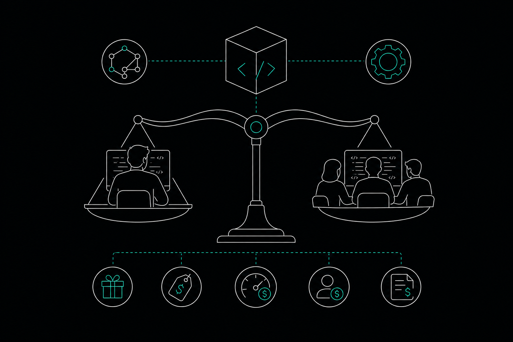

Choosing a code context tool used to mean picking between a free open-source option and an enterprise contract with a five-figure annual fee. That gap has closed. In 2026, code context tool pricing spans free community tiers, $9-per-month solo plans, per-seat team subscriptions, and platform contracts running into tens of thousands of dollars per year. Two teams solving the same problem can end up paying very different amounts depending on how they structure their usage.

This article breaks down the pricing models that matter, explains what each billing structure actually costs in practice, and helps you figure out which plan fits your workflow before you commit.

---

## What You Are Actually Paying For

Before comparing numbers, it helps to understand what the billing unit represents. Code context tools charge in a few different ways, and mixing them up makes comparisons misleading.

**Graph queries or MCP calls:** Structural tools that maintain a call graph typically charge per query against that graph. Each time an AI agent asks "what calls this function?" or "what would break if I change this?" counts as a query or MCP call.

**Token consumption:** Some tools have no seat fee and bill entirely on the tokens your AI model consumes. According to 8bitconcepts, Claude Code works this way — no monthly seat charge, just API token usage. Claude Sonnet 4.5/4.6, per the same source, is priced at $3.00 per million input tokens and $15.00 per million output tokens. A heavy session can accumulate cost quickly if the tool is feeding large file chunks into context rather than precise graph-backed answers.

**Flat seat fee:** Other tools charge a fixed monthly amount per seat regardless of usage. Predictable, but potentially expensive if usage is light.

Understanding which model a tool uses matters more than the headline price. A $9/month tool with a tight query cap and a $17/seat tool with 5,000 MCP calls per seat per month can end up costing similar amounts for a solo developer doing moderate work — but diverge sharply for a team running agents all day.

---

## The Main Pricing Tiers Across the Market

### Free and Community Tiers

Several tools offer a free entry point. The catch is usually a usage cap that makes the free tier suitable for evaluation or light personal projects, not daily professional use.

[Memtrace](https://memtrace.io/) offers a Community tier at no cost with 1,000 graph queries per month, then 50 per day after that. For a solo developer doing occasional agent-assisted work, that is enough to get a real sense of how graph-backed context changes your sessions. For anyone running two or more agents daily, the daily throttle will become a constraint within the first week.

Graphify is open-source under Apache 2.0 and costs nothing to self-host. The trade-off is that it builds its graph in batch, with no documented commit-aware continuous update mechanism — you get a snapshot of your codebase, not a live graph.

GitNexus (from Akon Labs) also runs fully locally and has a strong community following. Its free tier exists, but code review capabilities are gated behind an Enterprise tier still in private beta as of 2026.

### Individual Developer Plans ($9 to $17 per month)

This is the most competitive price band. Most tools targeting solo developers or small teams have landed somewhere in this range.

Memtrace's Pro tier is $9 per month, raising the graph query allowance to 5,000 per month with no daily throttle. Pro+ at $15 per month extends that to 20,000 queries per month. Both tiers include Cortex decision-recall (the ability to query why code was written a certain way), blast radius analysis, code review with AST detectors and graph-backed cross-module checks, and MCP integration with Cursor, Claude Code, Codex, Gemini CLI, Windsurf, and VS Code.

For context on where this sits in the market: codecontext.app lists a Team plan at $17 per seat per month billed annually, which includes 5,000 MCP calls per seat per month, according to codecontext.app's own pricing page. That is a higher per-seat price than Memtrace's Pro tier for a similar call volume, though the two tools have different feature sets and billing structures.

### Team and Organizational Plans ($29 per seat per month)

At the team level, pricing shifts from individual convenience to organizational control. You are paying for seat management, shared workspaces, and often self-hosted or data-sovereign options.

Memtrace's Teams tier is $29 per seat per month. It includes unlimited graph queries, self-hosted MemDB (the local graph database with bi-temporal indexing), an organization workspace, and seat pool enforcement. The self-hosted option matters for teams with data-sovereignty requirements who cannot send code context to a third-party cloud.

GitNexus's Enterprise tier is also $29 per seat per month, matching Memtrace's Teams price. GitNexus provides blast-radius and git-diff impact analysis and runs fully locally on its own native graph database (LadybugDB). The key difference at this price point: Memtrace includes code review at every tier, while GitNexus gates its equivalent review capability behind the Enterprise tier still in private beta.

Augment Code charges $100 per month flat for up to 50 seats. That works out to $2 per seat at full capacity, which sounds cheap — but the $100 floor means a 3-person team pays $33 per person per month. It provides semantic context retrieval rather than a deterministic structural call graph, has no self-hosted option, and has no blast-radius traversal or parallel-agent collision detection.

### Enterprise Contracts ($16,000 per year and up)

Sourcegraph starts at $16,000 per year, with a median contract around $81,000 per year. It is a heavyweight enterprise code intelligence platform built for large engineering organizations, not a lightweight graph layer you plug into Cursor or Claude Code. It caps chat context at 10 repositories per query and sits in a fundamentally different product category from the tools above.

Memtrace's Enterprise tier uses custom pricing and adds SSO, an air-gapped MemDB deployment, and dedicated deployment support — designed for organizations with compliance and isolation requirements, not for teams that simply want more query volume.

---

## How Usage Patterns Drive Real Cost

The headline price is only part of the story. How you use a tool determines whether the included allowance is enough or whether you are constantly hitting limits.

**Agent-heavy workflows consume queries fast.** If you run Cursor or Claude Code against a large repository and each agent turn triggers multiple graph lookups, 1,000 queries per month disappears in a few days of serious work. The Pro tier's 5,000 queries with no daily throttle is a more realistic baseline for someone using AI agents as a primary development tool.

**Session restarts are expensive in token-based tools.** When a tool feeds file content into context rather than querying a graph, restarting a session means re-loading that context from scratch. According to memtrace.io/benchmark, graph-backed context retrieval produces 84.7 percent fewer file-content tokens per session and 3.9 times more correct results per response token compared to competing approaches. That gap compounds across a full workday of agent sessions.

**Parallel agents multiply usage.** A team running three agents simultaneously against the same repository is not just tripling query volume — they are also creating the risk of overlapping edits. Memtrace's Fleet system handles this through intent publishing and lease acquisition, with human escalation for Class C conflicts. No other tool in this comparison documents an equivalent pre-merge collision detection system, and it is included in the Teams tier.

**Annual billing discounts.** Several tools in this space offer lower effective monthly prices when billed annually. Memtrace's published pricing does not specify an annual discount; check the pricing page directly for current billing options. CodeConductor/Harmony has no documented pricing at all as of 2026.

---

## Feature Comparison at Each Price Band

| Tier | Memtrace | GitNexus | Augment Code | Sourcegraph |
|---|---|---|---|---|
| Free | Yes (1,000 queries/mo) | Yes (limited) | No | No |
| ~$9–17/mo individual | $9 (Pro), $15 (Pro+) | Not documented | N/A | N/A |
| ~$29/seat team | $29/seat (Teams) | $29/seat (Enterprise) | $100/mo flat (up to 50 seats) | N/A |
| Enterprise | Custom | Custom | N/A | $16,000+/year |
| Code review at free tier | Yes | No (private beta) | No | No |
| Blast radius analysis | Yes | Yes | No | N/A |
| Decision-recall (why code exists) | Yes (all tiers) | Not documented | Not documented | Not documented |
| Self-hosted graph DB | Yes (Teams+) | Yes (all tiers) | No | Yes (enterprise) |
| Parallel-agent collision detection | Yes (Fleet) | Not documented | No | No |
| Continuously maintained graph | Yes | Batch only | N/A | N/A |

---

## Which Plan Fits Which Situation

**Solo developer, moderate AI usage:** Memtrace Pro at $9 per month covers 5,000 queries with no daily throttle, includes full Cortex decision-recall, and connects to whatever AI coding tool you already use. If you are primarily evaluating, the Community tier is a genuine free option — not a crippled demo.

**Solo developer, heavy agent usage:** Pro+ at $15 per month gives you 20,000 queries per month. If you are running agents across a large Rust or TypeScript codebase for most of your working day, this is the tier that keeps you from hitting limits mid-session.

**Small engineering team (5 to 15 people):** Memtrace Teams at $29 per seat per month is the natural comparison point against GitNexus Enterprise at the same price. The differentiators here are code review availability (included in Memtrace, gated in GitNexus), parallel-agent collision detection via Fleet, and bi-temporal MemDB history for rewinding and replaying episodes. Augment Code's $100 flat fee is cheaper per seat at full capacity but lacks structural graph analysis and any self-hosted option.

**Organization with compliance requirements:** Memtrace Enterprise or Sourcegraph, depending on whether you need a lightweight graph layer or a full enterprise code intelligence platform. Sourcegraph's $16,000 minimum is a significant floor; Memtrace Enterprise is custom-priced and built for teams that need graph capabilities with air-gapped deployment.

---

## FAQs

**What is the cheapest way to start using a code context tool in 2026?**

Several tools offer free tiers. Memtrace's Community tier is free with 1,000 graph queries per month, then 50 per day. Graphify is open-source and free to self-host. GitNexus also has a free tier, though its code review features are gated behind an Enterprise plan still in private beta.

**Is per-seat pricing or usage-based pricing better for a small team?**

It depends on how evenly usage is distributed. Per-seat pricing is predictable and scales linearly. Usage-based pricing — like token consumption in Claude Code — can be cheaper if some seats are light users, but can spike unexpectedly when agents run long sessions or restart context frequently.

**What happens when you exceed your included query allowance?**

On Memtrace's Community tier, you drop to 50 queries per day after the monthly 1,000 are used. Pro and Pro+ have no daily throttle. Teams queries are unlimited. Check the specific tool's documentation for overage behavior, since some tools block requests while others charge per additional call.

**Does annual billing reduce the effective monthly cost?**

Some tools in this space offer annual billing discounts. Memtrace's published pricing lists monthly rates; visit memtrace.io for current billing options. CodeConductor/Harmony has no documented pricing as of 2026, so annual billing terms are unknown.

**What is the difference between semantic context retrieval and a structural call graph?**

Semantic retrieval finds code that is conceptually similar to your query using embeddings. A structural call graph maps the actual function-call relationships in your code. For blast radius analysis — understanding what breaks if you change a function — you need the structural graph. Augment Code uses semantic retrieval; Memtrace, Graphify, and GitNexus build structural graphs.

**Is there a meaningful cost difference between running agents with and without a code context tool?**

Yes, if the tool reduces how much file content gets loaded into context. According to memtrace.io/benchmark, graph-backed context retrieval produces 84.7 percent fewer file-content tokens per session. Since tools like Claude Code bill on token consumption, that reduction directly lowers your API costs per session.

**Do team plans include features that individual plans do not?**

Yes. Memtrace's Teams tier adds self-hosted MemDB, an organization workspace, seat pool enforcement, and Fleet parallel-agent collision detection at scale. Individual Pro and Pro+ tiers include the core graph features, Cortex decision-recall, and code review, but are designed for single-developer use rather than coordinated multi-agent or multi-engineer workflows.

---

## The Bottom Line

Code context tool pricing in 2026 is genuinely tiered in a way that matches different working patterns. A solo developer doing occasional AI-assisted work can start free and upgrade to $9 per month when daily limits become a constraint. A team running multiple agents against a shared codebase needs the organizational controls and unlimited queries that come at the $29 per seat level. Enterprise contracts exist for organizations with compliance requirements, but the $16,000 floor on tools like Sourcegraph puts them in a different category entirely.

The more important question than price is what the tool actually does with your codebase. A tool that feeds raw file content into context costs you in tokens every session. A tool that maintains a live structural graph and answers precise queries costs you in subscription fees — but those fees tend to be smaller than the token waste they prevent.

Explore the full feature set and pricing tiers at [Memtrace](https://memtrace.io/).
