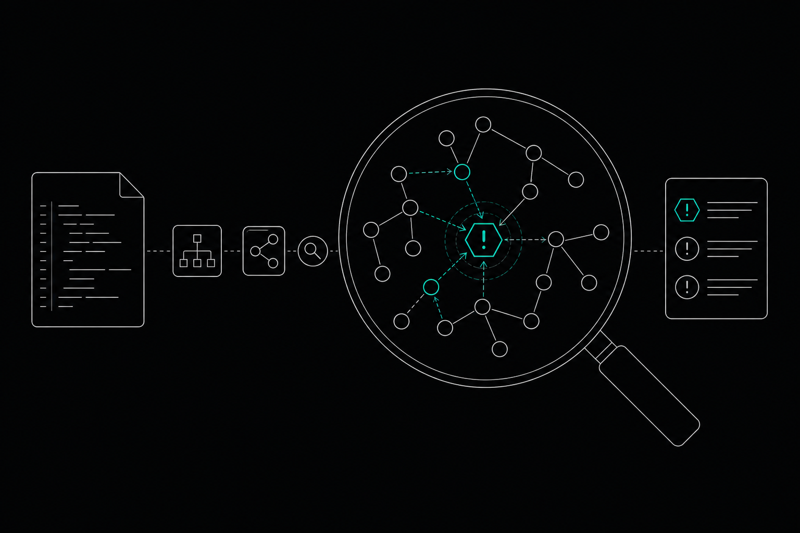

Code dependency analysis maps what your code relies on, both direct and transitive, so you can spot security and architectural risk early. Parse source into syntax trees, resolve imports, build a graph, match it against vulnerability data, then consider reachability to judge which dependencies are exploitable before you change anything.

This guide covers each part of that path, from parsing source into a first graph to understanding which findings deserve attention.

## What is code dependency analysis?

Code dependency analysis is the practice of finding every piece of code your project relies on and recording how those pieces connect. The output is usually a dependency graph: nodes for files, modules, or packages, and edges for "imports," "calls," or "requires."

A dependency graph for code answers two kinds of questions. Security questions: which libraries do you ship, and are any of them vulnerable? Structural questions: if you change this module, what else breaks?

The topic matters because you write less of your own code than you think. According to [GitHub's software composition analysis guide](https://github.com/resources/articles/what-is-software-composition-analysis), as much as 94% of modern software code is composed of third-party, open-source components. You inherit their bugs, their update schedules, and their own dependencies.

Package-level and code-level analysis answer different questions:

- **Package-level:** reads manifest files such as `requirements.txt` or `package.json` and lists the libraries you install.
- **Code-level:** reads the source itself and records which files import which modules, and which functions call which.

Package-level analysis tells you what you installed. Code-level analysis tells you what you use. You need both, and the steps below move from the first toward the second.

## Direct, transitive and circular dependencies: what are you really depending on?

A direct dependency is one you import yourself. A transitive dependency is one you never named: it arrives because something you import imports it. Your manifest lists the first kind. The second kind makes up most of the graph and hides most of the risk.

Packages sit at both ends of the size scale. Veracode research from 2022 found that 49.3% of software packages have zero dependencies. That figure comes from one vendor's analysis, so don't read it as a rule for every ecosystem. Plenty of packages are leaves, and a few sit at the center of everything.

Small packages can carry outsized weight. A 2026 study on arxiv.org found that micro-dependencies such as the `ms` library, which has over 829,000 dependents despite being only 37 lines of code, present major structural risks that standard tools often miss. One tiny node, a huge blast radius.

Coupling terms for reading a graph:

- **Afferent coupling:** how many other modules depend on this one. High means many things break if you change it.
- **Efferent coupling:** how many modules this one depends on. High means it breaks when anything it uses changes.

Circular dependencies form when module A depends on B and B depends back on A, directly or through a longer chain. They make testing harder because you can't load one module in isolation: a unit test for A drags in B, which drags in A. They also tangle build order and import timing, which can cause slow startups and initialization bugs.

## Steps 1 and 2: How do you build a dependency graph from source code?

Building the graph takes two steps: parse each source file into an abstract syntax tree (AST), then resolve each import to the exact file or package it names. Do these two and you have a graph you can trust.

1. **Parse source into abstract syntax trees.** An AST is a structured representation of code that a parser produces. Reading the tree, rather than searching text, separates real imports from the word "import" inside a comment or a string. Regex-based scanning gets this wrong often.
2. **Resolve each import to its target.** Apply the module rules of the language to find the exact file or package an import statement refers to. Python looks through the current package, then `sys.path`. Node follows `node_modules` lookup. TypeScript and bundler setups add path aliases like `@/utils`, which you map back to real directories using the project's config.

Here is code dependency analysis in Python, using the standard library's `ast` module:

```python
import ast
from pathlib import Path

def imports_in(path):
    tree = ast.parse(Path(path).read_text())
    found = set()
    for node in ast.walk(tree):
        if isinstance(node, ast.Import):
            found.update(a.name for a in node.names)
        elif isinstance(node, ast.ImportFrom) and node.module:
            found.add(node.module)
    return found

graph = {str(p): imports_in(p) for p in Path("src").rglob("*.py")}
```

That loop gives you an edge list: each file and the modules it imports. A comment reading `# import os` produces nothing, because the parser never sees it as code.

Relative imports such as `from. import config` need one more pass. Convert them to absolute module names using the file's own location before you add edges. Then separate the targets into three groups: your own modules, standard library, and third-party packages. Only the third group maps to anything you install.

## Step 3: How do you visualize a dependency graph?

Visualization turns the edge list into something you can read. Start with a small worked example, then pick the view that fits your question.

Take a service with four modules. `api.py` imports `orders.py` and `auth.py`. Both of those import `db.py`. `db.py` imports one third-party package, `sqlalchemy`, which pulls in its own transitive packages. This dependency graph example has one clear hub: `db.py` has three incoming edges, so a change there reaches every other module. That is afferent coupling made visible.

Most teams already have a viewer. Each one shows a different slice:

| Option | What it shows | What it misses |
|---|---|---|
| GitHub dependency graph | Packages declared in your manifest files, plus alerts on known issues | Imports that never appear in a manifest; function-level links |
| IDE diagram features (Visual Studio, IntelliJ) | Module and class relationships inside the open project, with cycles highlighted | Third-party transitive trees; usage across other repositories |
| SCA tool reports | Direct and transitive packages matched against vulnerability data | Internal module structure; how your own code calls them |

A dependency graph in Visual Studio works well for a single solution, and the GitHub dependency graph works well for package inventory. Neither shows both layers together.

Check any picture against three things:

1. **Hubs:** nodes with many incoming edges.
2. **Cycles:** loops between modules.
3. **Leaves with large reach:** tiny packages many things depend on, like the micro-dependency case above.

If your graph has hundreds of nodes, filter before you draw. Collapse third-party packages into one node each, or show only edges touching a module you plan to change.

## Steps 4 to 6: What is reachability analysis and why does it cut the noise?

Reachability analysis decides whether code that contains a vulnerability can actually run in your application. It turns a long alert list into a short one. The three steps below cover it.

1. **Correlate dependencies with vulnerability databases.** Match each package and version against a CVE source, a public record of a known vulnerability. Rank matches by severity and by how much the affected service matters to your business.
2. **Validate that each dependency is used.** Confirm the package is imported and executed in your application code, not just installed. Your graph from steps 1 and 2 answers this directly.
3. **Run reachability analysis.** Trace call paths from your code into the vulnerable function. If no path exists, or the function sits behind a feature you never enable, the finding is not exploitable in your implementation.

Volume is why this matters. New CVE reports reached a record 40,009 in 2024, up 38% from 2023, according to jit.io's 2025 analysis. No team triages that by hand.

Scanners over-report because they match on what is installed, not on what runs. Endor Labs reported in 2023 that while 90% of code in modern apps is open source, only 12% of that code is actually invoked by the application. That is one vendor's figure, so treat the exact ratio as indicative. The gap between installed and invoked code is where false positives come from.

Real exposure still exists. A 2025 Black Duck audit of 965 commercial codebases found that 86% contained open-source vulnerabilities, and 90% used open-source components more than four years old. Reachability tells you which of those to fix first.

## What if your legacy codebase has no manifest files?

Without manifests, you analyze the source itself. That is the code-level path from earlier, and it works when there is no `package.json`, no `pom.xml`, and sometimes no build system at all.

Use this order:

1. **Parse include and import statements directly.** For C and C++, read `#include` lines. For other languages, read the import syntax with a real parser, not a text search.
2. **Resolve them against directory layout.** Search the project's own folders first, then known system paths. A header found inside the repo is an internal edge. A header found only in a system directory is an external one.
3. **Fall back to heuristics for the rest.** Match unresolved names against vendored folders, such as `third_party/` or `vendor/`, and against library names in linker flags or old build scripts.
4. **Record what you could not resolve.** Keep an explicit list of unresolved includes. That list is your honest error bar.

Accuracy drops here, and you should say so in any report you hand to others. Macros can change which header gets included. Conditional compilation hides branches. Vendored copies of libraries often carry no version, so you can't match them cleanly against vulnerability data. Expect gaps. Treat the graph as a floor on what you depend on, not a full inventory.

For auditing, you can still pair IDE diagram features with a software composition analysis (SCA) tool, which inventories open-source packages and matches them to known vulnerabilities. SCA tools vary widely in cost, so request quotes from several vendors and compare what each covers for languages without manifests.

## From package graphs to a code graph: how do you see blast radius before you edit?

A package graph tells you what you installed. A code graph tells you what a change will touch. It links functions, callers, APIs, and tests across one repository, so you see the blast radius before you edit.

Your steps 1 and 2 already produce the raw material: parsed files and resolved imports. A code graph goes one level down. Each node is a function or class, and each edge is a call, a reference, or a test that exercises it. Ask "who calls `db.connect`?" and you get a list of callers, not a guess.

[Memtrace](https://memtrace.io/) is a code graph tool that builds and maintains a local graph of functions, callers, and tests for developers and coding agents. Developers and coding agents query it through MCP (Model Context Protocol, a standard way for coding tools to call external services) before they change anything. The graph tracks the codebase as it evolves, so the answer reflects the code as it is now. See [how Memtrace gives agents persistent structural memory](https://memtrace.io/codemap).

Memtrace handles the structural half of this guide: callers, execution paths, affected tests, and the hubs and cycles you found in step 3. Keep your SCA tool for the security half.

The Community tier is free and covers a first pass on one repository. Higher tiers raise the query limits.

One caveat: reliable public benchmarks for what code tangling costs large enterprises are scarce. Be wary of any precise percentage you see quoted for lost performance or productivity. The micro-dependency study shows the shape of the problem: a 37-line library can sit under more than 829,000 dependents. It does not show a general cost. SCA licensing also varies by vendor and contract, so compare quotes instead of trusting a published figure.

Use the graph for these checks before an edit:

1. List the direct callers of the function you plan to change.
2. Trace one execution path from an entry point to that function.
3. Find the tests that cover it. If none appear, write one first.

Prices and plan limits verified as of November 2026.

## FAQs

### What is the difference between afferent and efferent coupling?

Afferent coupling counts the modules that depend on a given module. Efferent coupling counts the modules that a given module depends on. High afferent coupling means a change there ripples outward. High efferent coupling means the module breaks when anything it relies on changes. Together they show which parts of your graph are fragile and which are load-bearing.

### How do circular dependencies impact software testing and performance?

A circular dependency means two or more modules depend on each other, directly or through a chain. You can't test one in isolation, because loading it pulls in the others, which pull it back in. Cycles also complicate build order and import timing, which can cause slow startups and initialization bugs that only appear at runtime.

### Why do standard vulnerability scanners produce so many false positives?

Most scanners match on what is installed, not on what your code runs. A package can contain a vulnerable function your application never calls. Endor Labs reported in 2023 that only 12% of the open-source code in modern apps is actually invoked. Reachability analysis closes that gap by tracing whether a call path reaches the flaw.

### How do you resolve path aliases in different programming languages?

Read the project's own configuration and map each alias back to a real directory. TypeScript uses `paths` in `tsconfig.json`. Bundlers such as webpack and Vite keep aliases in their config files. Python has no alias system, so resolution follows the package layout and `sys.path`. Resolve aliases before you add edges, or the graph will list them as missing packages.

### Is the GitHub dependency graph enough on its own?

No. It shows packages declared in your manifest files and flags known issues in them. It does not show imports that never appear in a manifest, and it has no function-level links. Use it for package inventory, then add source-level parsing for what your code imports and calls.

### How often should you rerun dependency analysis?

Rerun it whenever dependencies or structure change: on every merge for the package graph, and whenever you plan a risky edit for the code graph. New CVEs appear constantly, so a clean result last month says little about today. Automating the run in CI keeps the graph from going stale.

## Conclusion

Code dependency analysis comes down to a short sequence: parse to syntax trees, resolve imports, draw the graph, match it to vulnerability data, then use reachability to find what is exploitable. Package graphs show what you installed. Code graphs show what a change will break.

Start with one repository. Build the import graph, mark the hubs and cycles, and list which flagged packages your code actually calls. Fix those first, and check callers and tests before each edit.