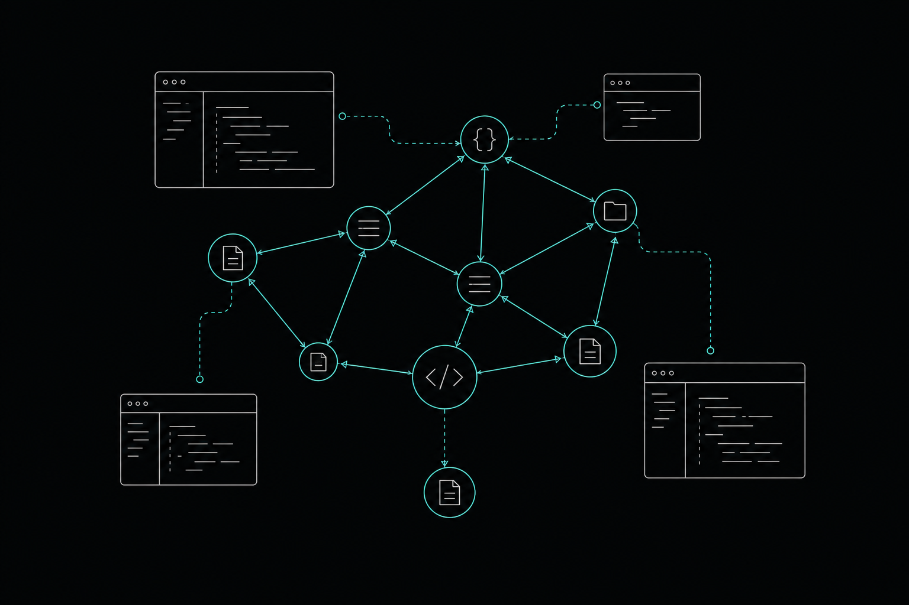

# Code Graph Explained: What It Is and How It Works

A **code graph** is one of those concepts that sounds academic until you've watched an AI agent confidently refactor a function and silently break three services it never knew existed. If you work with large repositories or run AI coding agents daily, understanding what a code graph is and how it works will change how you think about codebase intelligence.

This article covers code graphs from the ground up: what they are, how they're built, where they outperform simpler approaches, and where they fall short.

---

## What Is a Code Graph?

A code graph is a structured representation of a codebase as a network of nodes and edges. Rather than treating source code as a pile of text files, it models the relationships between the things inside those files: functions, classes, modules, APIs, tests, and the connections between them.

The simplest way to picture it: every function is a node, and every call from one function to another is an edge. Scale that up to include imports, inheritance hierarchies, API endpoints, and test coverage links, and you have a graph that captures how a codebase actually behaves — not just what it says on the surface.

That distinction matters more than it might seem.

---

## Nodes and Edges: The Building Blocks

### What nodes represent

Nodes correspond to identifiable units of code or structure:

- **Functions and methods** (the most common node type)
- **Classes and interfaces**
- **Files and modules**
- **API endpoints**
- **Tests and test suites**
- **Configuration or schema definitions**

The granularity depends on the tool and the use case. A graph built for blast-radius analysis needs function-level nodes. One built for high-level architecture review might only need module-level nodes.

### What edges represent

Edges encode the relationships between nodes:

- **Calls** (function A calls function B)
- **Imports** (module X imports from module Y)
- **Inheritance** (class Child extends Parent)
- **References** (variable or symbol usage)
- **Data flow** (value passed from one scope to another)
- **Test coverage** (test T exercises function F)

The combination of node types and edge types determines what questions you can answer. A graph with only call edges can trace execution paths. Add import edges and you can detect circular dependencies. Add test coverage edges and you can ask which tests will break if a function changes.

---

## How a Code Graph Is Built

Building a code graph starts with parsing. The tool reads source files and produces an Abstract Syntax Tree (AST) for each one — breaking code into its syntactic structure: function declarations, argument lists, return types, call expressions, and so on.

From the AST, a static analysis pass extracts the nodes and resolves the edges. Resolving edges is the hard part. When function A calls `utils.format(value)`, the graph builder needs to determine which specific `format` function that refers to, accounting for imports, namespaces, and any aliasing. In statically typed languages like TypeScript or Go, this resolution is fairly reliable. In dynamically typed languages like Python or Ruby, it involves heuristics and can produce incomplete or incorrect edges.

Once the initial graph is built, it gets stored in a database. The choice of storage matters. A relational database can handle simple graph queries but struggles with multi-hop traversals. A purpose-built graph database handles traversals natively and can answer questions like "find all callers of this function, then find all callers of those callers" without expensive joins.

---

## Why Code Graphs Beat Text Search and Vector Retrieval

The standard alternatives to a code graph are grep, embeddings, and vector search. Each has real uses. None of them answers structural questions.

**Grep** finds text patterns. It can locate every file that mentions `processPayment`, but it can't tell you which of those mentions is an actual function call versus a comment, a string literal, or a variable name. It has no concept of the call graph.

**Vector search and embeddings** convert code into semantic representations and find chunks similar to a query. This works well for "find code that does something like X." It works poorly for "find every function that calls X and could break if X changes." Semantic similarity is not the same as structural dependency.

A code graph answers structural questions directly. It can trace callers, find all paths between two functions, identify which tests cover a given module, and map which services depend on a particular API endpoint — the questions that matter most when you're about to make a change.

Research has validated the practical difference. In its 2025 report, arXiv (Cornell University) found that a graph-integrated approach achieved a 43.00% resolution rate on SWE-bench Lite using the open-source Qwen2.5-72B model, surpassing the previous best open-source method by 12.33%. The Association for Computational Linguistics, in its 2025 report on CODEXGRAPH, evaluated graph-integrated systems across three benchmarks and five real-world coding applications, providing early evidence that structural graph access improves agent performance on repository-level tasks.

---

## Where Code Graphs Are Most Useful

### Impact analysis before edits

Before changing a function, you want to know what else will break. A code graph traces all callers, all dependent services, and all tests that exercise the function — what's commonly called blast radius analysis. Without a graph, you're either running the full test suite and hoping, or manually tracing imports across dozens of files.

### Codebase context for AI agents

AI coding agents like Cursor, Claude Code, and OpenAI Codex work within token windows. On a large repository, those windows fill up fast with file contents that may not be relevant to the current task. A code graph lets an agent query for exactly the nodes and edges it needs, rather than loading entire files. According to memtrace.io/benchmark, this structural approach produces 84.7% fewer file-content tokens per session and 3.9x more correct results per response token compared to competing tools.

### Dependency tracing and architecture understanding

When you join a new codebase or revisit one after months away, the graph tells you how things connect. Which modules are tightly coupled? Which services call this internal API? Which functions are called by nothing? These questions take hours with manual reading and seconds with a graph.

### Code review and cross-module checks

A graph-backed reviewer can catch problems that file-level linters miss. If a change in module A breaks an interface contract that module B depends on, a graph-aware reviewer catches it. A linter that only sees module A does not.

---

## When a Code Graph Is Overkill

A code graph isn't always the right tool. For a small project under a few thousand lines, a well-organized file structure and good naming conventions may be sufficient. The overhead of building and maintaining a graph adds complexity that a simple project doesn't need.

Similarly, if your primary use case is semantic search — "find code that does something like this natural language query" — embeddings and vector search are faster to set up and often good enough. Code graphs shine when the questions are structural, not semantic.

---

## Freshness: The Synchronization Problem

A code graph is only as useful as it is current. A graph built from a snapshot three days ago will give you wrong blast-radius results if functions have been added, renamed, or removed since then.

This is a real operational challenge. Some tools build their graph in batch, on a schedule or on demand. Others rebuild on each commit. The best approach is continuous, commit-aware maintenance: the graph updates as the repository changes, so queries always reflect the current state of the code.

Batch-built graphs are better than nothing, but they introduce a subtle class of bugs where the graph tells you a function has two callers when it actually has five. Developers who trust a stale graph may make changes that break things the graph no longer knows about.

---

## Failure Modes Worth Knowing

### Dynamic language limitations

In Python, JavaScript, and Ruby, method dispatch can happen at runtime in ways that static analysis can't fully resolve. A function passed as a callback, a method called via `getattr`, or a dynamically constructed class name can all produce edges the graph misses. This doesn't make code graphs useless in dynamic languages, but edge completeness should be treated as a confidence score, not a guarantee.

### Incomplete cross-repository edges

Most code graph tools operate within a single repository. If your architecture spans multiple repos and services communicate via HTTP or message queues, those cross-service edges are typically absent unless the tool explicitly supports cross-repo API topology mapping.

### False positives from overloading

In languages that support method overloading or duck typing, a call edge might point to multiple possible targets. The graph may show an edge to the wrong implementation, or show several candidate edges when only one is actually reachable at runtime.

---

## Code Graphs, Code Property Graphs, and Knowledge Graphs

These three terms get conflated. They're related but distinct.

A **code graph** (as described in this article) models structural relationships: calls, imports, inheritance, references.

A **code property graph (CPG)** extends this by combining the AST, control flow graph, and program dependence graph into a single unified structure. CPGs were originally developed for security analysis and vulnerability detection. They're more expressive but also more expensive to build and query.

A **knowledge graph** is a general-purpose graph that can represent any entities and relationships. Applied to code, it might include documentation, issue tracker links, commit history, and team ownership alongside structural relationships. It's broader but less specialized.

For most developer and agent use cases, a well-maintained code graph hits the right balance between expressiveness and practical cost.

---

## Local-First and Privacy Considerations

Where the graph lives matters for teams with data-sovereignty requirements. A cloud-hosted graph means your code structure, function names, and API topology leave your infrastructure. For many teams that's acceptable. For teams in regulated industries, or those working on proprietary algorithms, it isn't.

Local-first graph databases keep the graph on your machine or within your private network. Queries never leave your environment. This is a meaningful architectural difference, not just a marketing distinction.

---

## How Memtrace Uses a Code Graph

[Memtrace](https://memtrace.io/) builds and maintains a live, navigable code graph that connects functions, callers, APIs, and tests across your repository. The graph stays current as the codebase evolves, so blast-radius queries and execution-path traces always reflect the actual state of the code.

The graph is stored in MemDB, a local-first graph database with bi-temporal indexing. Bi-temporal means the database tracks two independent time dimensions: Transaction Time (when a fact was recorded) and Valid Time (when it was true in the codebase). This lets you rewind the graph to any point in history, replay an episode, or ask how the graph evolved over time — not just what it looks like right now.

Cortex, Memtrace's decision-memory system, adds something no pure structural graph provides: the reasoning behind code decisions. When an agent or developer calls `why_is_this_here` or `recall_decision`, Cortex surfaces the rationale recorded when the code was written. It's active by default on every tier, including the free Community plan.

Fleet handles the parallel-agent coordination problem. When two agents or two engineers are about to edit overlapping parts of the codebase, Fleet's intent publishing and lease acquisition system detects the collision before it happens. Class C conflicts escalate to a human rather than silently merging into a broken state.

All of this connects to Cursor, Claude Code, OpenAI Codex, Gemini CLI, Windsurf, and VS Code via MCP — without changing your existing workflow.

---

## Conclusion

A code graph gives you something text search and vector retrieval cannot: a structural map of how your code actually connects. Built from parsers and static analysis, stored in a graph database, and kept current as the repository changes, it answers the questions that matter most before you make a change — what will break, who calls this, and why was it written this way.

The research is catching up to what practitioners already know. The tools are getting better at keeping graphs fresh, handling dynamic languages, and integrating directly into AI agent workflows. If you're working with a growing codebase and running AI agents daily, a code graph is no longer an academic curiosity. It's the foundation that makes those agents reliable.

Explore what a live, continuously maintained code graph looks like in practice at [memtrace.io](https://memtrace.io/).

---

## Frequently Asked Questions

**What is a code graph?**
A code graph is a database of nodes and edges representing the structural relationships inside a codebase. Nodes correspond to functions, classes, files, and APIs. Edges represent calls, imports, inheritance, and references. Together they let you answer questions about how code connects and what depends on what.

**How is a code graph different from vector search or embeddings?**
Vector search finds code that is semantically similar to a query. A code graph answers structural questions: which functions call this one, which services depend on this API, which tests cover this module. These are different questions, and only the graph can answer the structural ones reliably.

**What are the main failure modes of a code graph?**
Dynamic language limitations (method dispatch that can't be resolved statically), incomplete cross-repository edges when services communicate over HTTP or queues, and stale graphs that haven't been updated since the last commit. Freshness and edge completeness are the two most common practical problems.

**When is a code graph not worth the overhead?**
For small projects under a few thousand lines, or when your primary need is semantic search rather than structural dependency tracing, a code graph adds complexity without proportionate benefit. It becomes valuable when the codebase is large enough that manually tracing dependencies becomes unreliable.

**What is the difference between a code graph and a code property graph?**
A code property graph (CPG) combines the AST, control flow graph, and program dependence graph into one structure, originally designed for security analysis. A code graph typically focuses on structural relationships like calls and imports. CPGs are more expressive but more expensive to build and query.

**How does a code graph help AI coding agents?**
Agents work within token windows. Loading entire files to find relevant context is wasteful. A code graph lets an agent query for exactly the nodes and edges relevant to the current task, reducing token consumption and improving the accuracy of the context the agent receives.

**What is bi-temporal indexing in a code graph database?**
Bi-temporal indexing tracks two independent time dimensions: when a fact was recorded in the database (Transaction Time) and when it was actually true in the codebase (Valid Time). This lets you rewind the graph to any historical state, replay past episodes, and understand how the codebase structure evolved over time — rather than only seeing the current snapshot.
