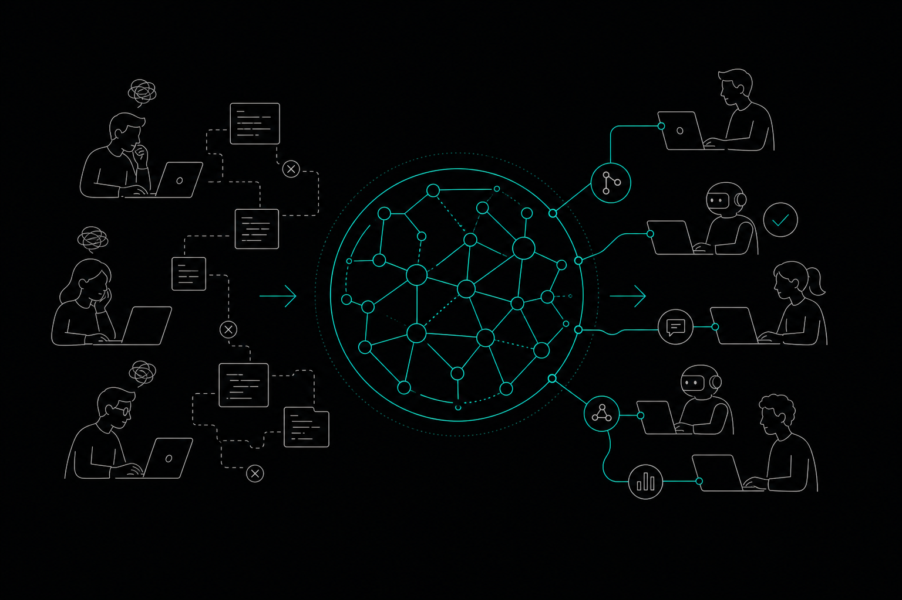

# Code Graph for Teams: Scaling Context Across Engineers

- [Why Context Breaks Down at Team Scale](#why-context-breaks-down-at-team-scale)
- [What a Code Graph Actually Does for a Team](#what-a-code-graph-actually-does-for-a-team)
- [The Multi-Agent Problem Teams Are Running Into](#the-multi-agent-problem-teams-are-running-into)
- [How Memtrace Addresses Team-Scale Context](#how-memtrace-addresses-team-scale-context)
  - [Code Map: One Graph, Every Engineer](#code-map-one-graph-every-engineer)
  - [Blast Radius Analysis Before Every Edit](#blast-radius-analysis-before-every-edit)
  - [Cortex: Decision Memory Across the Team](#cortex-decision-memory-across-the-team)
  - [MemFleet: Pre-Merge Collision Detection](#memfleet-pre-merge-collision-detection)
  - [MemDB: Graph History That Doesn't Forget](#memdb-graph-history-that-doesnt-forget)
- [Fitting Into Your Existing Toolchain](#fitting-into-your-existing-toolchain)
- [Pricing for Teams](#pricing-for-teams)
- [What to Expect When You Roll This Out](#what-to-expect-when-you-roll-this-out)
- [FAQs](#faqs)
- [Start With the Graph](#start-with-the-graph)

A shared codebase grows faster than shared understanding. One engineer knows why the payment service retries on 503. Another knows which callers depend on that behavior. A third just ran an AI agent that rewrote the retry logic without asking either of them. By the time the PR lands, the damage is done.

A **code graph for teams** solves this at the structural level. Instead of relying on Slack threads, tribal knowledge, or hoping your AI agent read the right file, every engineer and every agent queries a single, continuously maintained graph of how the codebase actually works. This article explains what that looks like in practice, why it matters as teams grow, and how to set it up without replacing the tools your team already uses.

---

## Why Context Breaks Down at Team Scale

A solo developer can hold most of a small codebase in their head. At five engineers, that starts to slip. At fifteen, it's gone. Each person builds a mental model of their own domain and works from incomplete assumptions about everything else.

AI coding agents make this worse. An agent running in Cursor or Claude Code has no persistent memory between sessions. It reads whatever files you give it, generates plausible-looking code, and moves on. It doesn't know that the function it just modified is called by three other services. It doesn't know the PR from eight months ago that explains why that logic exists. It doesn't know that another agent, running in a different terminal, is editing the same module right now.

The result is broken merges, redundant work, and regressions that take hours to trace back to their source.

---

## What a Code Graph Actually Does for a Team

A code graph maps the structural relationships in your codebase: which functions call which, which APIs are exposed, which tests cover which paths, which services depend on which modules. That map is queryable. Before any edit, a developer or agent can ask: what would this change affect?

That's blast radius analysis. The difference between "I think this is safe to change" and "I can see that this function is called by four services and tested in six places."

But blast radius is only part of the value. Code isn't just structure — it's accumulated reasoning. Why is this retry set to three attempts? Why does this endpoint return 204 instead of 200? Those answers live in git history, PR descriptions, and ticket comments. A code graph that connects structural relationships to that reasoning lets engineers and agents query the *why*, not just the *what*.

---

## The Multi-Agent Problem Teams Are Running Into

Most teams running AI coding agents at any scale have already hit some version of this: two agents editing overlapping code, neither aware of the other. Or one agent completing a refactor while a human engineer is mid-way through a related change. The merge conflict is the first signal that something went wrong, but by then both changes need to be untangled.

This is a coordination problem, and most current toolchains don't have a good answer for it. Git handles conflicts after the fact. Code review catches them later still. What's missing is pre-merge awareness of intent — knowing that Agent A has acquired a lease on the payment module before Agent B starts editing it.

---

## How Memtrace Addresses Team-Scale Context

[Memtrace](https://memtrace.io/) is a code intelligence platform built specifically for this problem. It maintains a live, commit-aware code graph that connects functions, callers, APIs, and tests across your repository. Engineers and agents query that graph before making changes, not after.

Here's what that looks like in practice.

### Code Map: One Graph, Every Engineer

Memtrace's Code Map gives every member of your team a navigable, live view of the codebase's structure. It's not a static diagram you generate once and forget. It updates as the codebase evolves, so the graph your agent queries on Tuesday reflects the merge that landed Monday night.

This matters because stale graphs are worse than no graph. If your code intelligence tool requires a manual re-run to stay current, engineers stop trusting it. Memtrace maintains the graph continuously, so the map always reflects the actual code.

### Blast Radius Analysis Before Every Edit

Before any edit, Memtrace traces all callers and dependent services. An agent editing a shared utility function can see, before writing a single line, which other modules will be affected. That's not a warning after the fact — it's structural awareness built into the edit workflow.

This is where the benchmark figures become meaningful. According to memtrace.io/benchmark, Memtrace delivers 84.7% fewer file-content tokens per session and 3.9x more correct results per response token. The graph replaces brute-force file loading with precise, targeted context. Agents get what they need without burning tokens on files that aren't relevant.

### Cortex: Decision Memory Across the Team

Cortex is Memtrace's decision-recall system. It connects git history, PR descriptions, comments, and ticket references into queryable decision nodes. An engineer joining a team six months in can run `why_is_this_here` on a function and get back the reasoning recorded when it was written. An agent can call `recall_decision` before modifying a module to understand the constraints that shaped it.

Cortex is active by default on every tier, including the free Community plan. No configuration required. The decisions your team makes today become queryable context for every engineer and agent that touches that code later.

### MemFleet: Pre-Merge Collision Detection

MemFleet is Memtrace's answer to the parallel-agent coordination problem. When an agent or engineer begins working on a module, they publish their intent and acquire a lease. MemFleet tracks those leases across the team. If two agents or two engineers attempt to work on overlapping code at the same time, the system detects the collision before merge.

For serious conflicts — what Memtrace calls Class C conflicts — the system escalates to a human rather than letting the merge proceed. No other tool in this space documents an equivalent pre-merge intent system. Git conflicts catch the symptom. MemFleet catches the cause.

### MemDB: Graph History That Doesn't Forget

MemDB is Memtrace's local-first graph database, and what sets it apart is bi-temporal indexing: it tracks both Transaction Time (when Memtrace recorded a fact) and Valid Time (when that fact was true in the codebase). That means you can query the graph as it existed at any point in the past, replay episodes, and trace how the codebase evolved over time.

For teams debugging regressions, this is genuinely useful. Instead of manually bisecting git history, you query the graph at the time the bug was introduced and see exactly what the call structure looked like then. The Teams tier includes self-hosted MemDB with an organization workspace, so your graph history stays on your own infrastructure.

---

## Fitting Into Your Existing Toolchain

Memtrace connects to your existing tools via MCP (Model Context Protocol). It works with Cursor, Claude Code, OpenAI Codex, Gemini CLI, Windsurf, and VS Code. You don't replace your coding tools — you add a graph layer that makes all of them smarter.

For teams already running agents across multiple tools, this is the practical path forward. Each agent queries the same graph. Each engineer sees the same structural map. Context is shared because the source of truth is shared.

Code review is also included at every tier, including free. Memtrace's reviewer combines AST detectors, YAML rule packs, and graph-backed cross-module checks. It posts to GitHub via the GitHub App and responds to `@memtrace` commands in PR comments — deterministic, graph-aware review without adding a separate paid tool.

---

## Pricing for Teams

Memtrace's Teams tier is $29 per seat per month. That includes unlimited graph queries, self-hosted MemDB, an organization workspace, and seat pool enforcement. For teams that want to start smaller, the Community plan is free with 1,000 graph queries per month, and the Pro plan is $9 per month per developer.

Compare that to Augment Code, which requires a $100 per month minimum for cloud indexing, or Sourcegraph, which starts at $16,000 per year. Memtrace's pricing is designed for teams growing into this kind of tooling, not teams that have already committed a six-figure infrastructure budget to it.

---

## What to Expect When You Roll This Out

The first thing your team will notice is that agents stop asking for files they've already seen. The graph gives them precise context, so they request what they need rather than loading everything. That's the token reduction in practice.

The second thing is that engineers stop asking each other "do you know why this works this way?" The answer is in the graph. Cortex has it.

The third thing — which takes a little longer to surface — is that broken merges from parallel agent work become rare. MemFleet catches the collisions before they become your problem.

---

## FAQs

**What is a code graph for teams, and why does it matter at scale?**
A code graph maps the structural relationships in your codebase: functions, callers, APIs, tests, and dependencies. At team scale, it gives every engineer and every AI agent a shared, queryable view of how the code actually works — replacing fragmented tribal knowledge with a single source of truth.

**How does Memtrace keep the code graph current as the team's codebase changes?**
Memtrace maintains the graph continuously and commit-aware. When code changes, the graph updates automatically. You don't run a batch job or trigger a manual re-index. The graph your agent queries always reflects the current state of the repository.

**What is blast radius analysis and how does it help teams?**
Blast radius analysis traces all callers and dependent services before any edit is made. It tells an engineer or agent which other parts of the codebase will be affected by a proposed change, so the team can assess risk before the change is written — not after it's merged.

**How does MemFleet prevent parallel agents from stepping on each other?**
MemFleet uses intent publishing and lease acquisition. When an agent or engineer starts working on a module, they register their intent. If another agent or engineer attempts to work on overlapping code, MemFleet detects the collision. For serious conflicts, it escalates to a human before the changes can merge.

**Does Memtrace replace the coding tools my team already uses?**
No. Memtrace is a code intelligence layer that connects to your existing tools via MCP. It works alongside Cursor, Claude Code, OpenAI Codex, Gemini CLI, Windsurf, and VS Code without replacing any of them.

**Is code review included in the free plan?**
Yes. Memtrace's code review — including AST detectors, YAML rule packs, graph-backed cross-module checks, and GitHub App integration — is available at every tier, including the free Community plan.

**What does Cortex do and who benefits from it?**
Cortex is Memtrace's decision-memory system. It records the reasoning behind code decisions, connecting git history, PR descriptions, and ticket references into queryable nodes. Engineers joining an existing codebase and AI agents working on unfamiliar modules both benefit: they can query why code was written a certain way before changing it.

---

## Start With the Graph

Shared context doesn't happen by accident on a growing team. It requires a structure that every engineer and every agent can query, that stays current as the codebase changes, and that remembers the decisions that shaped the code over time.

That's what a code graph for teams provides. Memtrace builds and maintains that graph, connects it to your existing tools, and gives your whole team — human and AI — the same structural awareness before any edit lands.

Learn more at [memtrace.io](https://memtrace.io/).
