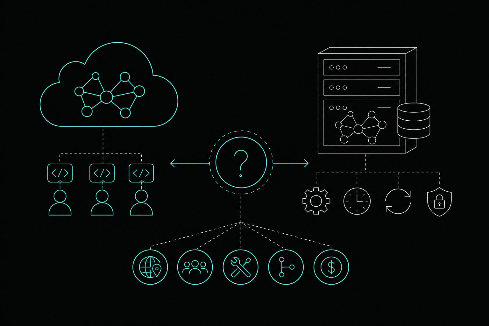

# Code Graph SaaS vs. Self-Hosted: How to Decide Fast

- [What "Self-Hosted Code Graph" Actually Means in 2026](#what-self-hosted-code-graph-actually-means-in-2026)
- [What Code Graph SaaS Actually Means](#what-code-graph-saas-actually-means)
- [Five Questions That Decide It](#five-questions-that-decide-it)
  - [1. Do you have a data-sovereignty or air-gap requirement?](#1-do-you-have-a-data-sovereignty-or-air-gap-requirement)
  - [2. How many AI agents are running concurrently?](#2-how-many-ai-agents-are-running-concurrently)
  - [3. Who will maintain the graph when it drifts?](#3-who-will-maintain-the-graph-when-it-drifts)
  - [4. Do you need to understand why code was written a certain way?](#4-do-you-need-to-understand-why-code-was-written-a-certain-way)
  - [5. What does "free" actually include?](#5-what-does-free-actually-include)
- [The Deployment Decision Matrix](#the-deployment-decision-matrix)
- [Where Self-Hosted Still Wins](#where-self-hosted-still-wins)
- [What the Middle Path Looks Like](#what-the-middle-path-looks-like)
- [Frequently Asked Questions](#frequently-asked-questions)

Choosing between a code graph SaaS and a self-hosted solution sounds like a straightforward infrastructure decision. It rarely is. The real question is whether your team wants to own the operational burden of keeping a graph current, or whether you want the graph to just work while you focus on shipping code.

This article walks through the five questions that actually matter, what each deployment model costs beyond the sticker price, and where the decision gets complicated for teams running AI coding agents at scale.

## What "Self-Hosted Code Graph" Actually Means in 2026

Self-hosted code graph tools like Graphify or GitNexus give you a binary or CLI you run on your own infrastructure. You control where the data lives. You also control when the graph gets rebuilt — which means you own the staleness problem.

Most open-source graph tools build in batch. You run a command, the graph generates, and then it sits there until someone re-runs it. On an active codebase with multiple developers or agents committing throughout the day, a batch-built graph can be hours out of date before anyone notices. That lag matters when an AI agent is tracing callers before editing a shared utility function.

Self-hosting also means absorbing the full operational surface: storage provisioning, version upgrades, CI/CD hooks to trigger rebuilds, and debugging when the graph diverges from the actual codebase. For a solo developer or a small team without dedicated DevOps capacity, that overhead adds up fast.

## What Code Graph SaaS Actually Means

A code graph SaaS manages the graph for you. It stays current as commits land, without you writing a rebuild script or scheduling a cron job. You query it through an API or MCP integration, and the answers reflect the current state of the repository.

The trade-off is that your code structure data lives on someone else's infrastructure, at least partially. For most startups, that is an acceptable trade. For teams handling regulated data, financial systems, or anything with a data-sovereignty requirement, it is a blocker.

The better SaaS options give you a middle path: a managed service for teams that want zero ops overhead, and a self-hosted database option for teams that need data residency without giving up the managed experience.

## Five Questions That Decide It

### 1. Do you have a data-sovereignty or air-gap requirement?

If yes, you need self-hosted storage at minimum. A pure cloud-hosted graph tool where code structure leaves your environment is not an option. Look for a SaaS that offers a self-hosted or air-gapped database tier rather than forcing a choice between fully managed and fully DIY.

Memtrace handles this with MemDB: the graph database can run locally on Teams plans or in a fully air-gapped environment on Enterprise, while the rest of the managed experience stays intact. You get continuous graph maintenance without shipping code structure to a third-party cloud.

### 2. How many AI agents are running concurrently?

One developer with one agent is a different problem from three developers each running two agents on overlapping parts of the codebase. The second scenario creates merge collisions that no static graph catches, because the collision happens in intent — not in the committed diff.

Self-hosted tools do not document collision detection at the agent level. They show you the graph; they do not watch what multiple agents are planning to edit simultaneously. If parallel agents are part of your workflow, that gap matters.

Memtrace's Fleet system publishes agent intent, acquires leases for destructive work, and escalates Class C conflicts to a human before any merge happens. That is a different category of problem from graph staleness, and one that self-hosted OSS tools are not built to solve.

### 3. Who will maintain the graph when it drifts?

With a self-hosted tool, the answer is you. Graphify and GitNexus both build graphs in batch with no documented continuous or commit-aware maintenance. When the graph drifts from the codebase, someone on your team has to notice, diagnose, and fix it.

With a managed SaaS, the graph stays current automatically. Memtrace keeps its code graph updated as the codebase evolves, so agents and developers are always querying current structure rather than a snapshot from last Tuesday.

If your team has the DevOps capacity and enjoys owning infrastructure, self-hosted is viable. If you are five to fifteen engineers focused on product velocity, graph maintenance is not where you want to spend attention.

### 4. Do you need to understand why code was written a certain way?

This question separates structural graph tools from decision-aware ones. Most code graph solutions — SaaS or self-hosted — show you what the code does: which functions call which, what the blast radius of a change is, how services connect. None of the major competitors document a system that records and surfaces why a decision was made.

Memtrace's Cortex system does this. It records the reasoning behind code decisions and surfaces them through queries like `recall_decision`, `verify_intent`, `get_arc`, `why_is_this_here`, and `governing_contracts`. Cortex is active by default on every tier, including the free Community plan. An agent asking why an authentication check is structured a certain way gets a real answer instead of a hallucinated one.

If your team is onboarding new developers, reviewing inherited code, or running agents on a codebase with years of accumulated decisions, this is not a nice-to-have.

### 5. What does "free" actually include?

Open-source self-hosted tools are free to run — but "free" in that context means free to download, not free to operate. You pay in infrastructure costs, maintenance time, and the engineering hours spent keeping the graph current and debugging when it breaks.

SaaS free tiers are different. Memtrace's Community plan includes 1,000 graph queries per month, Cortex decision-recall, and code review with AST detectors, YAML rule packs, graph-backed cross-module checks, GitHub App posting, and `@memtrace` commands. That is a meaningful set of capabilities at no cost, not a stripped-down demo.

For a solo developer or a small team evaluating before committing to a paid tier, the free tier is where you start.

## The Deployment Decision Matrix

| Situation | Recommended Path |
|---|---|
| Solo developer, no compliance requirements | SaaS free tier or Pro ($9/month) |
| Small team, no data-sovereignty requirement | SaaS Teams ($29/seat/month) |
| Team with data residency needs | SaaS with self-hosted DB (Teams or Enterprise) |
| Air-gapped environment | SaaS with air-gapped DB (Enterprise) |
| Team that wants to own all infrastructure | Self-hosted OSS (accept staleness trade-off) |
| Team running multiple parallel AI agents | SaaS with collision detection (Fleet) |

## Where Self-Hosted Still Wins

Self-hosted tools are not wrong. They are the right choice when your team genuinely wants to own the full stack, has the DevOps capacity to maintain it, and is comfortable with the staleness trade-off that comes with batch graph builds.

Graphify's open-source model gives you full transparency and no vendor dependency. GitNexus runs a native persistent graph database (LadybugDB) and supports 13 languages with hybrid search. If those properties matter more than continuous maintenance or decision-recall, self-hosted is a legitimate path.

The honest version of the self-hosted pitch: you get control and transparency in exchange for operational ownership. The honest version of the SaaS pitch: you get a current, maintained graph in exchange for trusting someone else to run the database — unless you choose a tier with self-hosted storage.

## What the Middle Path Looks Like

For most teams in 2026, the cleanest option is not "SaaS or self-hosted" as a binary. It is a managed service where you can bring your own storage when you need to.

Memtrace is built around this model. The graph stays current automatically via its local sidecar architecture. MemDB's bi-temporal indexing — Transaction Time and Valid Time — means you can query not just the current graph state but also rewind to any previous state and replay episodes, which no competitor documents. Self-hosted MemDB is available on Teams and Enterprise for teams that need data residency without running their own graph maintenance pipeline.

You connect it to whatever tools you already use: Cursor, Claude Code, OpenAI Codex, Gemini CLI, Windsurf, VS Code. Nothing in your existing workflow changes. According to memtrace.io/benchmark, this approach produces 84.7% fewer file-content tokens per session and 3.9x more correct results per response token versus competing approaches.

That combination — managed graph, self-hostable storage, MCP-based integration — is where the SaaS vs. self-hosted framing breaks down. The better question is not where the graph runs. It is whether the graph is current, queryable, and connected to the tools your agents are already using.

Start with the free tier at [Memtrace](https://memtrace.io/) and run it alongside your existing setup. The graph connects via MCP without replacing anything, so the evaluation cost is low and the answer to "SaaS or self-hosted" becomes clear quickly.

---

## Frequently Asked Questions

**What is the main difference between a code graph SaaS and a self-hosted code graph tool?**

A code graph SaaS manages graph maintenance for you, keeping it current as commits land without requiring you to schedule rebuilds or debug staleness. A self-hosted tool gives you full infrastructure control but puts the operational burden on your team. Most self-hosted tools build graphs in batch, meaning the graph can drift from the actual codebase between runs.

**Is self-hosted code graph tooling actually free?**

The software may be free to download, but running it is not free. You pay in infrastructure costs, engineering time for maintenance, and the overhead of keeping the graph current. A SaaS free tier like Memtrace's Community plan includes graph queries, decision-recall via Cortex, and code review at no cost — with the operational overhead handled for you.

**What happens to graph accuracy when multiple AI agents are working simultaneously?**

Most code graph tools, whether SaaS or self-hosted, show you the current structure but do not track what multiple agents are planning to change. Memtrace's Fleet system addresses this by publishing agent intent, acquiring leases for destructive work, and escalating conflicts to a human before they reach a merge. No documented equivalent exists in other tools.

**Can I use a code graph SaaS if my team has data-sovereignty requirements?**

Yes, if the SaaS offers a self-hosted or air-gapped database option. Memtrace's MemDB can run locally on Teams plans or in a fully air-gapped environment on Enterprise, so your code structure data stays on your infrastructure while the managed graph maintenance experience remains intact.

**What is bi-temporal indexing and why does it matter for a code graph?**

Bi-temporal indexing tracks two separate time dimensions: Transaction Time (when a fact was recorded in the database) and Valid Time (when that fact was true in the codebase). This lets you query not just the current graph state but also rewind to any past state and replay how the graph evolved. Memtrace's MemDB uses this model; no competitor currently documents an equivalent.

**How do I evaluate a code graph SaaS without disrupting my existing workflow?**

Memtrace connects via MCP (Model Context Protocol) to Cursor, Claude Code, OpenAI Codex, Gemini CLI, Windsurf, and VS Code. You add it alongside the tools you already use rather than replacing them. The Community tier is free, so you can run a real evaluation on your actual codebase before committing to a paid plan.

**When does self-hosted code graph make more sense than SaaS?**

Self-hosted makes sense when your team has dedicated DevOps capacity, wants full infrastructure ownership, and is comfortable accepting the staleness trade-off that comes with batch graph builds. It is also a reasonable choice if you want complete transparency into the tooling without any vendor dependency. For teams focused on product velocity without dedicated infrastructure resources, the operational overhead of self-hosting typically outweighs the control benefits.
