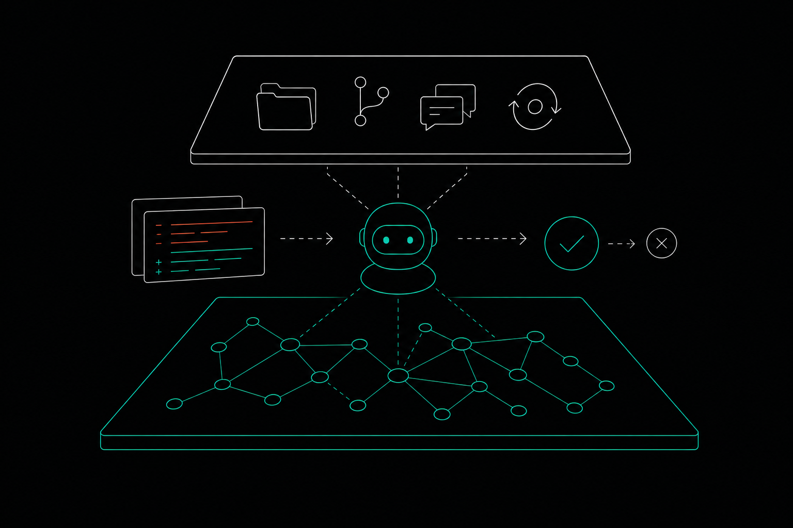

# Code Management Tool: How to Pick One for AI Agents

Pick a code management tool in two layers. First choose a Git host such as GitHub or GitLab for repositories, pull requests, and review. Then check how your agents get context and standards before they edit: written rules, path-based approvals, quality gates on agent code, and a way to see what a change affects.

Most guides stop at the first layer. That worked when only people wrote code. Now your agents edit the same repositories, and they need more than a place to push.

## What is a code management tool, and is Git still the standard?

A code management tool, also called a source code management (SCM) system, tracks every change to your code, stores the history, and lets several people work on the same repository without overwriting each other. It handles branches, merges, pull requests, and review.

Git is still the default. A 2026 developer survey found that 90.7% regularly use Git as their version control system. On top of Git, hosting platforms add collaboration. The JetBrains Developer Ecosystem Report 2026 found that 56.0% of developers use GitHub for professional projects.

That settles the first layer. You will almost certainly use Git, and you will pick a host to run it.

The second layer is new. Agents write code at a pace that review habits built for humans don't always cover. They need standards they can read, and they need to know what a change touches before they make it. The rest of this guide covers both layers in order.

## Step 1: Decide what your Git host must do

Start with the host's job. Write down what your team needs from it before you compare names.

For most teams, the baseline looks like this:

1. **Pull requests and review.** Every change, human or agent, goes through a reviewable diff.
2. **CI/CD.** Tests and builds run on every push.
3. **Security scanning.** Secrets and vulnerable dependencies get caught before merge.
4. **Access controls.** You can require specific people to approve changes to sensitive paths.
5. **AI-assisted review.** Something helps your reviewers keep pace with agent-written volume.

GitHub covers hosting, pull request workflows, and AI-native code review through Copilot, and its rulesets and CODEOWNERS enforce human approval on sensitive paths. GitLab combines repository hosting with built-in CI/CD and security scanning, and it supports self-managed and air-gapped deployments. The choice often comes down to where your team already works.

Then note where hosting stops. A Git host stores code and records who approved what. It doesn't tell an agent which functions call the one it is about to change. It doesn't say whether your standards allow the pattern the agent is about to write.

GitLab points at part of this gap with server-side access to specific repository data, aimed at easing bottlenecks when machines, not people, read the repo. That is the host layer adapting. The context layer, covered in Step 3, is a separate question.

## Step 2: Compare GitHub, GitLab and agent tools side by side

Compare these tools by role, not as rivals. A host stores and reviews code. A terminal agent changes it. You need both roles filled.

GitHub is the most common host among professional developers, with 56.0% using it. That matters in practice: contributors, integrations, and hiring all lean toward it. It doesn't make GitHub the right pick for every team. If you want CI/CD and security scanning in one platform, or need self-managed or air-gapped deployment, GitLab fits better.

Claude Code sits beside a host, not in place of one. It is a terminal-based agent that inspects a repository, runs commands, and makes code changes, and it suits developers who want local control. Your changes still land in GitHub or GitLab for review. Git remains the base for nearly everyone, with 90.7% of developers using it.

| | Primary role | Where it runs | Pricing tier |
|---|---|---|---|
| GitHub | Git hosting, pull requests, AI-native review via Copilot | Cloud | A paid plan |
| GitLab | Git hosting with built-in CI/CD and security scanning | Cloud, with self-managed and air-gapped options | A paid plan |
| Claude Code | Terminal agent that edits code and runs commands | Desktop app | Pricing not publicly listed |

What each agent knows before it edits is the question for the next step.

## Step 3: Check how the tool gives agents context before they edit

Judge a tool by what your agent knows before its first edit. An agent that starts from zero writes plausible code that breaks something it never saw.

Your team may not have closed this gap yet. The Qodo code quality report from August 2026 found that only 41.7% of 300 U.S. engineering leaders have centralized AI coding standards in place. In the same report, only 34.6% of 500 surveyed U.S. developers believe agents consistently follow the standards their organization sets. Both figures are vendor-reported survey results. They show the gap in practice, not that any one tool closes it.

Run any candidate through this checklist:

1. **Callers.** Can the agent see what calls the function it is about to change?
2. **Tests.** Can it find the tests that cover that code?
3. **APIs.** Does it know which endpoints and interfaces the change touches?
4. **Blast radius.** Can it estimate what else breaks before it edits, not after review?
5. **History.** Can it recall why the code was written this way?
6. **Freshness.** Does that context update as the repository changes, or does it go stale after the next merge?
7. **Fit.** Does it connect through the coding tools your agents already use, such as through MCP?

Plain text search over the repo fails most of these. It returns matches, not relationships.

Score each candidate honestly, and test it on a real change from your own repository rather than a demo. Demos are built to look good. Your repository has years of odd naming, half-finished migrations, and shared helpers that many files depend on, and that is where context gaps show up. Pick a function with several callers, ask the agent to modify it, and see whether the tool surfaces those callers and their tests before the edit. A tool that only impresses on a toy project tells you little about how it behaves on the code your team actually ships. A tool that passes fewer than three is a search box. A tool that passes five or more gives your agent structural context inside the coding loop.

Write the results in a short table: one row per candidate, one column per checklist item. Share it with the people who review agent pull requests. They know which mistakes slip through today, and they can tell you which checklist items matter most for your codebase.

## When a code graph layer beats another Git host

A second Git host won't fix an agent that edits blind. A code graph layer will.

Add one when your agents change code without knowing callers, APIs, and tests. The symptoms show up in review, when a person finds the broken caller instead of the agent. Or they show up after merge.

[Memtrace](https://memtrace.io/) is a code graph layer, not a Git host. It builds and maintains a local code graph that connects functions, callers, APIs, and tests across a repository. Developers and coding agents query that graph before they edit, to see blast radius, trace execution paths, and recall why code was written a certain way. It connects to your existing coding tools through MCP and keeps the graph current as the codebase changes.

That maps to the checklist above: callers, tests, APIs, blast radius, history, freshness, and MCP fit. You keep GitHub or GitLab for hosting and review. The graph supplies what hosting never stores.

If you want agents working from one shared context, see [MemCode · Your agents. One place to build.](https://memtrace.io/memcode). For how the graph keeps structural memory between sessions, read about [persistent structural memory for coding agents](https://memtrace.io/codemap).

Skip the graph layer if your repositories are small and one person holds them in their head. Add it when no one person can.

## Step 4: Set up governance and review for agent-written code

Governance turns standards into rules that agents and reviewers can both enforce. Work through these six actions in order:

1. **Write your standards down.** Document global engineering and compliance standards as written rules. Agents can't follow rules that live in someone's head.
2. **Sync the rules to your agents.** Give your coding agents access to those standards before they write code, not after review catches a violation.
3. **Require human approval on sensitive paths.** Configure path-based rulesets so specific human teams must approve changes to sensitive files. On GitHub, rulesets and CODEOWNERS do this.
4. **Gate agent-authored code.** Implement automated quality gates that scan agent-written code for security and quality patterns.
5. **Check infrastructure as code.** Apply policy-as-code checks to infrastructure changes in environments like Terraform or Kubernetes.
6. **Review the audit record weekly.** Look at rule violations across repositories and agents. Repeated violations point to a rule that is unclear or an agent that never receives it.

The survey numbers explain why steps 1 and 2 come first: only 41.7% of engineering leaders have centralized AI coding standards, and just 34.6% of developers believe agents follow them. If standards aren't centralized, downstream checks have nothing to enforce. If agents never receive the rules, even well-written standards change nothing. Fix the written rules first, then fix how they reach each agent, and only then tune the gates that catch what slips through.

Keep humans in the approval path for anything sensitive. An agent drafts the change. A named team approves it.

Start small if the full list feels heavy. Pick one repository, write the five or six standards reviewers repeat most often, and turn on path-based approvals for the two or three directories where a bad change costs the most. Once that works, copy the setup to the next repository. A narrow rollout that agents actually follow beats a broad policy that no one enforces.

## Step 5: Is there a free code management tool, and what does it cost to scale?

Yes. Git itself is free, and you can start the context layer at no cost too. GitHub and GitLab move to paid plans as you scale; check each vendor's current page for terms.

Memtrace prices the graph layer by query volume:

| Tier | Price | Graph queries |
|---|---|---|
| Community | Free | 1,000/month, then 50/day |
| Pro | $9/month | 5,000/month, no daily throttle |
| Pro+ | $15/month | 20,000/month |
| Teams | $29/seat/month | Unlimited, with self-hosted MemDB and an organization workspace |
| Enterprise | Custom | SSO, air-gapped MemDB, deployment support |

Start on Community with one repository. Move to Pro when the daily throttle slows your agents. Move to Teams when several people share one workspace.

A simple way to size it: count how many times a day your agents and developers ask what a change affects. If a single agent session runs many lookups, the daily cap on the free tier will show up quickly. If usage stays light, the free tier may be all you need for a long time. [Memtrace pricing](https://memtrace.io/plans) lists every tier in full.

Prices and plan limits verified as of November 2026.

## FAQs

### What is a source code management system?

A source code management system tracks every change to your code, stores the full history, and lets several people work on one repository without overwriting each other. It handles branches, merges, and pull requests. Git is the most common one, and nearly every hosting platform builds on it. Agents add a new reason to care, because every change they make needs a reviewable record.

### Is Git still used today?

Yes. Git remains the base layer for nearly every team, and hosting platforms build on top of it. Agents haven't changed that; they sit on top of the same repositories and push changes through the same pull requests, so your branching, review, and merge habits still apply to agent-written code.

### Is there a free code management tool?

Yes. Git is free and open, and Memtrace's Community tier is free with 1,000 graph queries a month, then 50 a day. GitHub and GitLab are paid plans at team scale. Start with Git and the free graph tier, then upgrade only when your agents hit a limit.

### What are some program management tools, and how are they different from code management tools?

Program management tools plan work: roadmaps, tickets, timelines, and resourcing. Code management tools track the code itself: changes, history, branches, and review. You use both. A ticket says what to build. A code management tool records how it was built and who approved it.

### Can I create my own code management setup instead of buying a platform?

Yes. You can run Git on your own server and add CI, scanning, and review tooling yourself. GitLab also supports self-managed and air-gapped deployments if you want a platform without the cloud. Budget for the ongoing maintenance, because you own every upgrade and outage.

### Do I need a separate tool if my team already uses GitHub Copilot?

Check against the Step 3 checklist. GitHub provides hosting and AI-native review through Copilot, but review is not the same as context before an edit. If your agents can't see callers, tests, and blast radius, a code graph layer fills that gap alongside GitHub.

### How often should I review agent rule violations?

Weekly. Review the audit records across repositories and agents so you catch patterns early. A rule that many agents break is probably unclear or never reaches them. Fix the rule or its delivery, then check the next week's records to confirm the count drops.

## Conclusion

Pick your Git host first, and pick it on pull requests, CI/CD, security scanning, and access control, not on popularity alone. Then check the second layer: whether your agents get written standards and structural context before they edit.

Start with the Step 3 checklist on your current setup. Score the tool, and write down your standards if you haven't. Then give agents the context to follow them.