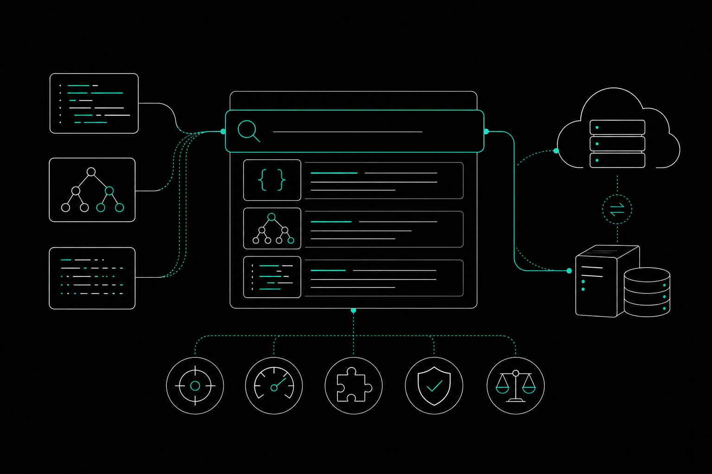

A codebase search tool earns its cost when it combines semantic indexing, low query latency, and MCP support for AI agents. The right choice depends on repository scale and whether you need local or cloud hosting. This guide walks through each dimension in the order you'd actually evaluate it: indexing method first, then performance, setup, infrastructure, and AI-agent compatibility.

## Semantic Indexing vs. Lexical Search: Which Approach Fits Your Codebase?

Semantic indexing and lexical search solve different problems. Knowing which one fits your workflow keeps you from paying for capabilities you won't use.

Lexical search, including grep and regex-based tools, matches exact strings or patterns. It's fast, deterministic, and requires no embedding model. You ask for `handlePayment` and you get every file that contains that string. The limitation is that it has no understanding of meaning. A function named `processCharge` that does the same thing won't appear in that result.

AST-based search improves on raw text matching by parsing code into a syntax tree. It understands structure: this is a function definition, that is a method call, this block is a conditional. You can query by symbol type, scope, or call relationship instead of string pattern. That structural awareness makes AST search more precise for refactoring tasks and cross-file dependency tracing.

Semantic search goes further by converting code into vector embeddings that capture meaning. A natural language query like "where does the app validate user input before writing to the database?" can return relevant functions even when none of them contain those exact words. The trade-off is cost and latency: embedding generation requires a model, and vector similarity search adds overhead compared to a plain grep.

Hybrid indexing combines lexical or AST precision with semantic recall. Research from indexical.dev indicates that a hybrid approach can achieve 97% recall while reducing median latency compared to pure semantic search. For most production codebases, that combination outperforms either method alone. Pure semantic search over-retrieves; pure lexical search misses conceptually related code. The practical question is whether the tool you're evaluating supports hybrid indexing or forces you to choose one mode, and whether you can verify that behavior against your own repo.

For small repos with consistent naming conventions, lexical search is often enough. For large, multi-language codebases where naming is inconsistent or where AI agents need to find code by intent rather than by symbol name, semantic or hybrid indexing pays for itself quickly.

## Performance Benchmarks: Query Latency, Recall, and Token Efficiency

Three metrics determine whether a codebase search tool actually helps in an AI-assisted workflow: how fast it returns results, how often those results are correct, and how many tokens it consumes doing so.

**Recall** measures how often the relevant code appears in the result set. In an agent loop, missing context leads to edits that break untouched code. The hybrid indexing research from indexical.dev puts achievable recall at 97%, which is a useful reference point when setting expectations for a tool you're evaluating.

**Latency** matters because coding agents make many search calls per session. A tool that takes two seconds per query adds up fast across a multi-step agent loop. Benchmarks from Codegraff show that codedb achieved a quality score of 4.65 compared to other backends in their 2026 tests. That same benchmark found codedb_context made 12x fewer tool calls than a standard CLI during SWE-bench lite localization tests. Fewer calls at comparable quality means less waiting and less context window consumed per task. These results come from Codegraff's own vendor-reported benchmarks, not an independent third-party study, so treat them as directional rather than definitive.

**Token efficiency** is the metric most teams underweight. Every file chunk passed into an agent's context window costs tokens. A tool that retrieves 20 loosely relevant files costs far more than one that retrieves 4 precise ones. CocoIndex claims its code search tool delivers 70% token savings for coding agents, though that figure comes from CocoIndex itself and has not been independently verified.

Proper indexing strategy also affects raw execution speed. A fintech case study reported by indexical.dev described a 400% performance improvement after switching indexing approaches. That's a single reported result from one organization, not a general benchmark, but it illustrates the ceiling for improvement when indexing is the bottleneck.

When you evaluate a tool, ask for latency numbers at your repo's scale, not at a demo scale. Performance at small repos does not predict performance at large ones. Token cost per query is equally important: check whether the tool reports it, and whether you can inspect what was retrieved and why.

## How to Set Up a Codebase Search Tool: From Indexing to First Query

Most codebase search tools follow the same setup sequence. The steps below describe a representative workflow you'll encounter across tools that support configurable embedding providers.

1. **Enable indexing for your project.** Open the tool's settings and turn on codebase indexing either globally or scoped to a specific repository. Some tools index on first launch; others require you to opt in per project.
2. **Select and configure an embedding provider.** Choose from options such as OpenAI, Ollama, or Gemini depending on whether you need cloud-based or fully local embeddings. Enter the required API key or local endpoint URL. Local providers like Ollama avoid sending code to external servers, which matters for proprietary codebases.
3. **Save the configuration to start the initial scan.** The tool will crawl your repository, generate embeddings, and build the index. On a large repo, this can take several minutes. Most tools show progress and let you query once indexing reaches a usable threshold, rather than waiting for full completion.

After the initial index builds, verify the results by running a few known queries. Search for a function you know exists and confirm it appears in the top results. Then try a natural language query that describes behavior rather than naming a symbol. If both return relevant results, the index is working correctly.

Index freshness matters as much as initial setup. Check whether the tool updates incrementally as files change or requires a full rebuild. Incremental updates keep the index current without blocking your workflow between rebuilds.

## Local vs. Cloud Hosting: Infrastructure Requirements and Trade-offs

For most teams, the hosting decision comes down to two things: data sensitivity and scale. Local deployment keeps your code off external servers; cloud deployment offloads infrastructure management.

Local hosting runs the index and embedding model on your own machine or internal servers. No code leaves your network, which matters for regulated industries or proprietary codebases. The trade-off is that you manage the infrastructure yourself: storage for the index, compute for embedding generation, and a process to keep everything running as the repo grows. Embedding generation is the most resource-intensive step, and local models like Ollama are slower than cloud-hosted equivalents. For a large monorepo, initial indexing can take significant time on modest hardware. You don't need to meet specific RAM or CPU thresholds to get started, but you will feel the difference as repo size increases.

Cloud hosting moves that compute burden to a managed service. Queries tend to be faster, scaling is handled for you, and there's no server to maintain. The cost is that your code, or at least representative chunks of it, passes through an external provider. For teams without strict data residency requirements, that trade-off is usually acceptable.

A fintech case study reported by indexical.dev found a 400% performance improvement after switching indexing strategies. That result came from one organization and reflects their specific setup, not a universal outcome, but it shows how much headroom exists when infrastructure is the bottleneck.

Sourcegraph Amp Code runs as a cloud-based service and is designed for enterprise-scale repositories spanning millions of lines. Per lowcode.agency and sourcegraph.com, it requires a Sourcegraph deployment on top of AI costs, meaning teams take on a licensing and infrastructure dependency alongside the search capability itself.

For teams that need local control without building from scratch, self-hosted options with a managed graph layer offer a middle path worth evaluating before committing to either extreme.

## MCP Integration: How Codebase Search Tools Connect to AI Coding Agents

MCP, the Model Context Protocol, is a standard that lets AI coding agents call external tools, including codebase search, during a session. Without MCP, an agent has no structured way to query your index mid-task. It either relies on what's already in the context window or makes unguided file reads.

With MCP integration, the agent issues a structured search call, receives ranked results, and uses only the relevant code as context before it acts. That keeps the context window focused. Instead of loading entire directories, the agent retrieves the three or four functions that actually matter for the current edit. The result is fewer tokens spent and fewer irrelevant results influencing the output.

When evaluating MCP support in a search tool, check three things. First, does the tool expose a proper MCP server, or does it only offer a CLI wrapper that an agent can call indirectly? A native MCP server gives the agent typed inputs and structured outputs, which reduces parsing errors. Second, does the tool return metadata alongside results, such as file path, symbol type, and caller relationships? An agent that knows a function has twelve callers will make a different edit than one that sees the function in isolation. Third, how does the tool handle session state? Some MCP integrations start from zero on each call; others maintain a session so the agent can issue follow-up queries without re-specifying context.

Sourcegraph Amp Code supports agent-driven navigation across large repositories via its cloud infrastructure. ace-tool focuses on semantic search for prompt optimization and includes a Web UI for reviewing what the agent retrieved, per webkkk.net and santiagorm9.github.io. Both tools connect into agent workflows, but their MCP surface and query depth differ. Call efficiency varies significantly between implementations, which is why testing against your own repo and task type matters more than any single benchmark figure.

## Comparing Codebase Search Tools: Sourcegraph Amp Code and ace-tool

The two tools below represent different points on the scale and deployment spectrum. Neither has publicly listed pricing.

| Tool | Deployment | Best For | MCP Support | Pricing |
|---|---|---|---|---|
| Sourcegraph Amp Code | Cloud | Enterprise monorepos, multi-repo search at scale | Yes, via cloud agent infrastructure | Not publicly listed |
| ace-tool | Desktop app | Semantic search for AI prompt optimization on a single machine | Yes, requires API base URL and auth token | Not publicly listed |

Per lowcode.agency and sourcegraph.com, Sourcegraph Amp Code requires an active Sourcegraph deployment, which adds licensing overhead and an ongoing maintenance burden alongside the search capability itself.

ace-tool runs as a desktop application and focuses on improving the quality of AI prompts by finding relevant code context through natural language queries. Per webkkk.net and registry.npmjs.org, it requires an API base URL and authentication token to connect to an embedding provider. Its Web UI lets you inspect what the tool retrieved and how the prompt was enhanced before sending it to an agent.

The Codegraff benchmarks from 2026 show codedb achieving a quality score of 4.65 against other backends. These are vendor-reported results from Codegraff and reflect their specific test conditions, not a broad industry comparison.

Amp Code suits teams that already run Sourcegraph and need cross-repo agent navigation at scale. ace-tool suits individual developers or small teams who want to improve prompt quality on a local machine without managing server infrastructure. Neither is a direct substitute for the other.

## When a Code Graph Tool Is the Better Choice for AI-Assisted Development

Search finds code. A code graph tells you what happens when you change it.

That distinction matters most when an AI coding agent is about to make an edit. Knowing a function exists is useful. Knowing it has 14 callers, two of which feed into a payment API, is what prevents a bad deploy.

[Memtrace](https://memtrace.io/) is a local code graph tool that maps functions, callers, APIs, and tests across your repository so developers and coding agents can trace what an edit will touch before it runs. It connects to existing coding tools via MCP and keeps the graph current as the codebase evolves.

If your primary need is finding code by keyword or natural language query, a search tool handles that. If your primary need is understanding what an edit will touch before the agent acts, a code graph is the right layer to add.

The two approaches are not mutually exclusive. Many teams use search to locate code and a graph to reason about it.

Prices and plan limits verified as of October 2026.

## FAQs

### Do codebase search tools work with monorepos that span multiple languages?

Most modern codebase search tools support multi-language repositories, but the depth of support varies. Lexical and AST-based tools depend on language-specific parsers, so a language without a parser gets text-only treatment at best. Semantic tools rely on embedding models, which are generally language-agnostic for natural language queries but may miss language-specific idioms. Before committing to a tool, test it against the specific language mix in your monorepo.

### How often does a code index need to be rebuilt as the codebase changes?

That depends on whether the tool supports incremental updates. Tools with incremental indexing update only the files that changed, which keeps the index current without a full rebuild. Tools that require full rebuilds are better suited to scheduled jobs, such as nightly or on each CI run. For active codebases with frequent commits, incremental indexing is worth prioritizing during evaluation.

### Can codebase search tools be used without an AI coding agent?

Yes. Search tools work as standalone utilities for any developer who wants to find code by meaning rather than by exact string. Natural language queries, symbol lookups, and cross-file dependency traces are all useful in a manual workflow. AI-agent integration adds value by automating those queries during a task, but it is not a requirement for the tool to be useful.

### What embedding providers are commonly supported for local semantic search?

OpenAI, Ollama, and Gemini appear across most configurable tools. Ollama is the most common choice for fully local deployment because it runs the embedding model on your own hardware with no external API call. OpenAI and Gemini are cloud-hosted and faster for large initial indexing jobs, but they require sending code to an external server. The right choice depends on your data sensitivity requirements and the hardware available for local inference.

### Is there a meaningful quality difference between cloud-hosted and self-hosted indexing?

Index quality depends more on the embedding model and indexing strategy than on where the compute runs. Cloud-hosted services typically use larger models and return results faster because they run on dedicated infrastructure. Self-hosted setups using smaller local models may produce slightly lower recall, especially on ambiguous natural language queries. For most codebases, the gap is manageable. For very large repos or complex multi-language queries, the model quality difference becomes more noticeable.

## Conclusion

A codebase search tool earns its cost when it returns precise results quickly, keeps token usage low, and fits into your agent's workflow without adding friction. Indexing method, hosting model, and MCP integration together determine whether a tool performs at your repo's scale. No single feature decides it.

Start by identifying your real bottleneck. If your agents spend too many calls locating code, evaluate tools on recall and call efficiency. If your concern is understanding what an edit will affect before it runs, a code graph layer addresses that directly. Either way, test against your actual repository size and language mix before committing to a paid tier.
