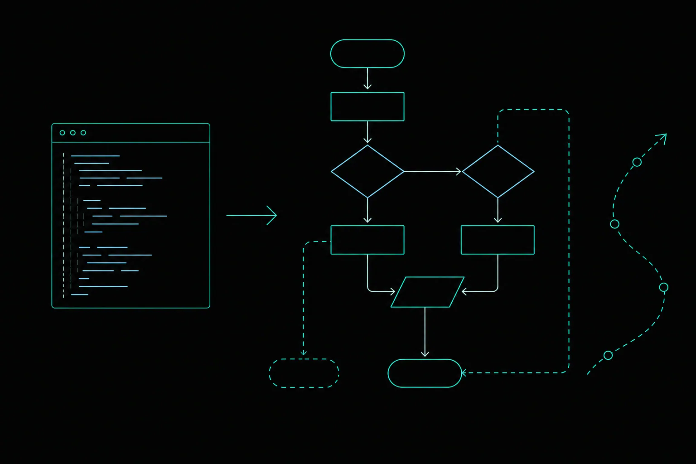

# Coding Flow Diagram: How to Map Code Paths Step by Step



- [What Is a Coding Flow Diagram and Which Symbols Do You Need?](#what-is-a-coding-flow-diagram-and-which-symbols-do-you-need)
- [Step 1 and 2: Set the Scope, Terminals, Inputs and Outputs](#step-1-and-2-set-the-scope-terminals-inputs-and-outputs)
- [Step 3: How Do You Turn if/else Statements Into Decision Branches?](#step-3-how-do-you-turn-ifelse-statements-into-decision-branches)
- [Step 4: How Do You Draw Loops, Early Returns and Error Paths?](#step-4-how-do-you-draw-loops-early-returns-and-error-paths)
- [Step 5: How Do You Verify the Diagram Against the Code?](#step-5-how-do-you-verify-the-diagram-against-the-code)
- [Pseudocode or Flowchart: Which Is Better?](#pseudocode-or-flowchart-which-is-better)
- [What Program Should You Use to Generate Flowcharts From Code?](#what-program-should-you-use-to-generate-flowcharts-from-code)
- [When One Function Isn't Enough: Mapping Code Paths Across a Repository](#when-one-function-isnt-enough-mapping-code-paths-across-a-repository)
- [FAQs](#faqs)
- [Conclusion](#conclusion)

To make a coding flow diagram, mark the function's start and end, list its inputs and outputs, turn each if/else into a labeled decision diamond, draw loops as back-edges to an earlier condition check, then trace sample values through the finished diagram to confirm it matches the code.

That is the whole method. The rest of this guide shows how to do each step by hand and how to check the result against the code.

## What Is a Coding Flow Diagram and Which Symbols Do You Need?

A coding flow diagram is a picture of how a piece of code runs. Boxes show actions, diamonds show decisions, and arrows show the order. It makes hidden code paths visible, which helps with documentation, debugging, and planning a change.

The idea is old. Flowcharts were first introduced to the ASME by industrial engineers Frank and Lillian Gilbreth in 1921, according to IBM's overview of flowcharts. The symbol set you need today is small.

| Symbol | Shape | What it means in code |
|---|---|---|
| Terminal | Rounded rectangle (oval) | Start or end of a function |
| Process | Rectangle | An assignment, a calculation, or a function call |
| Decision | Diamond | An if, else if, or loop condition with two or more exits |
| Input/output | Parallelogram | Reading arguments, printing, returning a value, or reading a file |
| Flow line | Arrow | The order of execution from one step to the next |

Use one arrow in and, for everything except a decision, one arrow out. Only a diamond branches. A rectangle with two exits has a decision hidden inside it.

Keep the words in the diagram close to the words in the code. A box that says "validate order" is vague. A box that says "total = sum(item.price)" you can check against a line.

## Step 1 and 2: Set the Scope, Terminals, Inputs and Outputs

Before you draw any logic, decide what the diagram covers. Place the start and end terminals, then list what goes in and out. This keeps the diagram from sprawling.

**Step 1: Identify the start and end terminals of the function.** Pick one function or one path through a larger flow. Name the start terminal after the function, such as `calculateDiscount`. Add one end terminal for a normal return. If the function can exit early or throw, plan an extra end terminal for each exit now, so you don't forget them later.

Scope is the main decision here. A diagram of one function stays readable. A diagram of all of "checkout" turns into a wall of boxes. If the code calls other functions, draw each call as one process box and map the called function in its own diagram.

**Step 2: Define inputs and outputs using parallelograms.** Read the function signature. Every parameter is an input. Every return value, printed line, or written record is an output.

Place one parallelogram right after the start terminal listing the inputs, for example "Input: cart, couponCode". Place another before each end terminal showing what leaves the function, for example "Return: finalTotal".

Also note any input the function reads from outside its signature, such as a config value, a global, or a database row. These are easy to miss and often cause surprising behavior.

After these two steps, you have a start terminal, an input parallelogram, an output parallelogram, and one or more end terminals, with nothing between them yet. The next step fills that gap.

## Step 3: How Do You Turn if/else Statements Into Decision Branches?

Each if/else becomes one diamond with two labeled exits, and each run of plain statements becomes one rectangle. Read the code top to bottom and draw in that same order.

**Step 4 in the method: Label decision branches clearly to indicate True/False paths.** Write the condition inside the diamond as a question. Label one exit "True" (or "Yes") and the other "False" (or "No"). Never leave an exit unlabeled. A reader should not have to guess which arrow the code takes.

Here is a small function:

```python
def shipping_cost(weight, is_member):
    if weight > 20:
        cost = 15
    else:
        cost = 5
    if is_member:
        cost = cost * discount_rate
    return cost
```

Draw it like this:

1. Start terminal: `shipping_cost`.
2. Input parallelogram: `weight, is_member`.
3. Diamond: `weight > 20?`
4. True arrow to a rectangle: `cost = 15`. False arrow to a rectangle: `cost = 5`.
5. Both rectangles feed one arrow into the next diamond: `is_member?`
6. True arrow to a rectangle: `cost = cost * discount_rate`. False arrow skips it.
7. Both paths join and flow to an output parallelogram: `Return cost`.
8. End terminal.

Notice that the two branches of the first decision rejoin before the second decision. Every branch must either rejoin the main flow or reach its own end terminal. A branch that goes nowhere points to a bug in the diagram or in the code.

For a switch or a chain of else-if statements, use one diamond per condition in sequence. When the cases are values of a single variable, use one diamond with several labeled exits instead, and use the case values as the labels.

## Step 4: How Do You Draw Loops, Early Returns and Error Paths?

A loop is a decision diamond with an arrow that returns to it. An early return or an error is an extra exit that goes straight to its own end terminal.

**Draw loop paths using back-edges that return to an earlier condition check [S3].** Put the loop condition in a diamond. The "True" exit leads into the loop body. The last box in the body draws an arrow back to that same diamond. The "False" exit leaves the loop and continues down the page.

A `for` loop has three parts: an initializer before the diamond, the condition in the diamond, and the increment as the last box before the back-edge. A `while` loop has only the condition and whatever the body changes. If no box inside the body can change what the condition tests, you have found an infinite loop.

Now combine a loop with a guard:

```python
def sum_valid(orders):
    if orders is None:
        return -1
    total = 0
    for o in orders:
        if o.amount < 0:
            continue
        total += o.amount
    return total
```

Draw it in this order:

1. Start terminal and an input parallelogram: `orders`.
2. Diamond: `orders is None?` True goes to an output `Return -1`, then its own end terminal.
3. False goes to a rectangle: `total = 0`.
4. Diamond: `more orders?` False goes to `Return total` and the main end terminal.
5. True goes to a diamond: `o.amount < 0?` True draws an arrow straight back to `more orders?`. That arrow is the `continue`.
6. False goes to `total += o.amount`, which also draws an arrow back to `more orders?`.

Two back-edges, one guard exit, one normal exit. If the function can throw, add a terminal labeled "Error" and connect it from the risky step.

## Step 5: How Do You Verify the Diagram Against the Code?

You verify a diagram by tracing sample values through it and checking that each step matches a line of code. **Verify the logic by performing a trace with sample values [S5].** Put a finger on the start terminal and follow the arrows as the computer would.

Run at least three traces:

1. **A normal case.** Pick typical inputs and confirm you reach the expected return.
2. **An edge case.** Use zero, an empty list, or a value exactly on a boundary such as `weight = 20`.
3. **A failing case.** Pass `None` or a bad value and confirm it reaches the error or early-return terminal.

Then run this checklist:

- Every diamond has labeled exits for each outcome.
- Every arrow leads somewhere. No loose ends.
- Every path ends at a terminal.
- Every box maps to a line or block you can point at.
- Every loop's back-edge reaches the condition check, and something in the body can change that condition.

Practice builds this skill under time pressure. Students in the IC2 practical exam get 15 minutes to complete both a code snippet and its corresponding flowchart (2026, sergiolearns.com). That is one course's rule, not an industry norm, but it shows how quickly the skill becomes routine.

Hand tracing is slow, and it depends on you choosing good inputs. Automated checks, covered later, can flag loose steps, but they only check the structure of the diagram. Only a trace tells you whether the diagram matches the intent.

## Pseudocode or Flowchart: Which Is Better?

Neither wins outright. They do different jobs, so pick by what you are doing.

Pseudocode suits planning. It is quick to write, easy to edit, and looks like the code you will write next. Use it to sketch an algorithm before you commit to a language.

A flowchart suits reviewing branching logic and explaining it to others, because you see every path at once and can spot a missing else or an unreachable branch.

Research on this question is mixed. A study comparing flowchart and pseudocode comprehension involved 114 participants across various skill levels (2022, IEEE Access). It does not settle the debate, so don't treat either format as proven faster for everyone.

Use this short guide:

1. **Planning a new algorithm:** start with pseudocode.
2. **Reviewing logic with many branches or loops:** draw a flowchart.
3. **Documenting for non-programmers:** use a flowchart.
4. **Documenting for developers who will edit it:** use pseudocode or text-based diagrams that live in the repo.

Many teams use both: pseudocode to plan, a diagram to check the result.

## What Program Should You Use to Generate Flowcharts From Code?

Three kinds of tools cover most needs: code-to-flowchart generators, text-based diagramming, and chat assistants. Pick by how much code you have and how long the diagram must stay accurate.

**Code-to-flowchart generators** read source and draw the diagram for you. Diagramsmith is one example. Its free version processes 60 lines of code at a time, and the Pro version raises that to 2,000 lines and adds a flow check for loose steps, per the vendor's [code-to-flowchart page](https://diagramsmith.com/code-to-flowchart/). Those limits are enough for a single function, not a whole module.

**Text-based diagramming** such as Mermaid lets you write the diagram as plain text and render it from that text. Because the file is text, you can commit it next to the code, review it in a pull request, and diff it when logic changes. Of the three options, it is the easiest to keep current.

**Chat assistants** can draft a flowchart if you paste in a function and ask for Mermaid output. Yes, ChatGPT-style assistants can do this. Treat the result as a first draft. They can skip an else branch or invent a step, so run the Step 5 trace on anything they produce.

Whichever you choose, the check is the same: trace sample values through the output before you trust it.

## When One Function Isn't Enough: Mapping Code Paths Across a Repository

A single-function flowchart can't show who calls the function, which APIs it touches, or which tests cover it. Real changes cross files, so the diagram you need often spans a repository.

Keep top-level diagrams small. A standard top-level software block diagram should contain 6 to 12 blocks to stay architecturally clear (2024, EmbeddedRelated). Past that, split the view and link to a per-function diagram for the detail.

Hand-drawn diagrams don't answer the question that matters before an edit: what does this change touch? A code graph does. [Memtrace](https://memtrace.io/) is a local code graph tool that maps functions, callers, APIs, and tests across your repo for developers and coding agents. You or your agent query it before the next edit to see the blast radius and trace execution paths. It connects to your existing coding tools via MCP and keeps the graph current as the code changes. Memtrace gives coding agents [persistent structural memory for AI coding agents](https://memtrace.io/codemap), so no session starts from zero.

Memtrace is not a flowchart drawing tool, and it doesn't export diagrams. Use it to find the paths worth drawing, then draw them. The Community tier is free: 1,000 graph queries a month, then 50 a day.

## FAQs

### What is the definition of a flowchart in programming?

A flowchart in programming is a diagram that shows how code runs, step by step. Rectangles show actions, diamonds show decisions with labeled exits, parallelograms show inputs and outputs, and arrows show the order of execution. It lets you see every path through a function at once, including the ones that are easy to miss when reading code line by line.

### Can ChatGPT draw a flowchart from code?

Yes, a chat assistant can draft a flowchart if you paste in the code and ask for text-based output such as Mermaid. Treat it as a first draft. Assistants can drop a branch or add a step the code doesn't have, so trace normal, edge, and failing values through the result before you rely on it.

### What program should I use for flowcharts?

It depends on the job. Use a code-to-flowchart generator for a quick diagram of one function. Use text-based diagramming such as Mermaid when the diagram must live in the repo and change with the code. Use a chat assistant for a fast first draft. Whatever you pick, verify the output by tracing sample values.

### How many blocks should a top-level software diagram have?

A standard top-level software block diagram should contain 6 to 12 blocks to stay architecturally clear. If yours needs more, split it into several views and give each subsystem its own diagram. Small diagrams are easier to review and easier to keep current.

### Do free code-to-flowchart tools have size limits?

Some do. Diagramsmith's free version processes 60 lines of code at a time, and its Pro version raises the limit to 2,000 lines. Those figures are vendor-reported and apply to that tool only. Check the limit of any generator before you paste in a long file.

### When should I use a flowchart instead of a sequence diagram?

Use a flowchart when you want to show decisions, loops, and branches inside one piece of logic. Use a sequence diagram when you want to show how several components or services pass messages over time. If the question is "what happens inside this function," draw a flowchart. If it is "who calls whom," draw a sequence diagram.

## Conclusion

A coding flow diagram works when you scope it to one function, label every branch, draw loops as back-edges, and trace real values through it before you trust it. Automation and text-based diagrams save time, but the trace is what proves the diagram matches the code.

Next, pick one function you changed recently and draw it with the five steps. Then put the diagram in a text format beside the code, so the next person to edit the function updates it too.