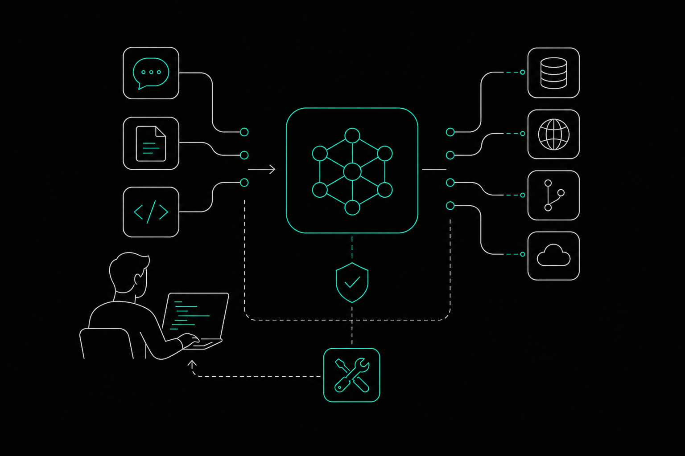

Model context protocol tools are servers that expose structured capabilities to AI agents and coding assistants via a shared protocol. Those capabilities range from file access and repo management to database queries and payment platform integrations. The ecosystem has grown fast, but quality is uneven: a vanishingly small fraction of servers meet high documentation and reliability standards, so the filter you apply before adopting a server matters as much as the list you start from. This article covers how the protocol works, which servers are worth using today, what security risks to watch for, and how to build your own. It focuses on what you need to act on that information, not a comprehensive survey of every option.

## What Are Model Context Protocol Tools?

An MCP tool is a server that implements the Model Context Protocol and exposes one or more callable capabilities to an AI client. The client might be a coding assistant, an autonomous agent, or an IDE plugin. When the agent needs to read a file, query a database, or open a pull request, it calls the appropriate tool through a standardized interface rather than through a one-off API integration.

The architecture is client-server. The AI client connects to one or more MCP servers, each of which declares what tools it offers. The client discovers those tools at runtime, reads their input schemas, and decides which to call based on the task at hand. Data from [Small Print's 2026 stats](https://smallprint.dev/stats) shows the median MCP server currently provides 7 distinct tools, which gives a sense of how granular these capability sets tend to be.

Two transport methods carry the messages between client and server. The first is **stdio**, used for local servers that run as a subprocess on the same machine. The second is **HTTP with Server-Sent Events**, used for remote servers that expose an endpoint over the network. Local stdio servers are simpler to sandbox but require the agent to have process-level access to the host. Remote HTTP servers are easier to share across teams but introduce network latency and authentication requirements.

A tool that runs only over stdio cannot be shared across a distributed team without extra infrastructure. A tool that runs over HTTP needs OAuth or token-based auth to stay secure. Both transport types appear in the tools covered below.

## The MCP Tools List: A Snapshot of the Ecosystem

The MCP ecosystem is large and growing at a pace that makes any static list outdated quickly. According to [Arcade's 2026 report](https://www.arcade.dev/documents/state-of-mcp-tools.pdf), monthly server downloads grew from 100,000 in late 2024 to 97 million by March 2026, a 970x increase. Arcade reports this figure from its own download data, so treat it as directional rather than a verified industry count, but the order of magnitude is consistent with what developers see in public registries.

Scale does not equal quality. The absence of a centralized, verified registry means anyone can publish a server, and many do without documentation, tests, or any signal of maintenance. According to Arcade's ToolBench index, only 0.5% of analyzed servers earned an A grade for documentation and reliability. That finding is vendor-reported and based on Arcade's own grading rubric, but even with generous margins of error, the signal is clear: most servers in public listings are not production-ready.

What does that mean practically? When you browse a public MCP registry, the majority of entries are likely to be incomplete implementations, abandoned experiments, or thin wrappers with no error handling. Before adopting any server, check for an active commit history, a documented input schema, explicit error responses, and some form of authentication support. A server that fails any of those checks is a liability in an agent workflow, where a bad tool call can cascade into broken code or leaked credentials.

Enterprise-backed servers from vendors such as GitHub, Databricks, and payment platforms such as Stripe represent a different tier. They carry organizational accountability, published documentation, and maintained SDKs. They are not automatically safe, but they clear the baseline quality bar that most community-published servers do not.

## Best Model Context Protocol Tools Worth Using Today

They cover three distinct use cases: repository management, data platform access, and local file operations.

| Tool | Primary Use Case | Transport / Runs | Pricing Tier |
|---|---|---|---|
| GitHub MCP Server | Repository management | Cloud (hosted or Docker) | Not publicly listed |
| Databricks Managed MCPs | Data platform and catalog access | Cloud | Not publicly listed |
| Filesystem Reference Server | Local file read/write | Local stdio | Not publicly listed |

### 1. GitHub MCP Server

The GitHub MCP Server gives AI agents direct access to repository operations through the MCP protocol. An agent can create issues, submit pull requests, and view diffs without leaving its context window or requiring a custom API wrapper.

Authentication uses OAuth or a personal access token. You can run the server as a hosted endpoint managed by GitHub, or pull the Docker image and self-host it if your organization requires data to stay on-premises. The hosted path is faster to set up; the Docker path gives you more control over network boundaries.

The practical value here is precision. Instead of an agent scraping a web page or guessing at repository state from a cloned copy, it calls a tool that returns structured data about the current state of the repo. That reduces hallucinated file paths and stale context, two failure modes that show up frequently in agent-driven code workflows.

One thing to verify before deploying: the server's OAuth scope. GitHub's permission model is granular, and an over-scoped token gives an agent write access to repositories it should only read. Scope your token to the minimum the workflow requires.

### 2. Databricks Managed MCPs

Databricks Managed MCPs expose Unity Catalog functions, tables, and vector indexes directly to AI assistants and IDEs. If your organization stores analytical data, feature tables, or embeddings in Databricks, this server lets an agent query that data without you building a custom retrieval layer.

Per docs.databricks.com, the Unity Gateway beta must be enabled before most services become accessible. OAuth is the supported authentication method for production use. That dependency on a beta feature is worth noting: it means the integration is not yet stable for all Databricks configurations, and you should test against your specific Unity Catalog setup before relying on it in an agent pipeline.

This server is marked single-source in the available documentation, meaning independent verification of its behavior is limited. Treat it as a strong option if you are already on Databricks, but validate the connection yourself rather than assuming the documentation covers your exact environment.

The use case is narrow but valuable. An agent that can query a vector index or call a catalog function mid-task can make data-informed decisions without a human in the loop. That is a meaningful capability for teams building analytical or data-heavy agent workflows.

### 3. Filesystem Reference Server

The Filesystem reference server is the official example implementation from the MCP project. It lets an AI model read and write files within a specified local directory sandbox, making it the starting point most developers reach for when they want to understand how MCP tools work in practice.

It runs over local stdio only, which means it cannot be shared across a network. Every path the agent can access must be explicitly allowed at startup. That explicit allowance requirement is a security feature, not a limitation: it forces you to define the blast radius of the agent's file access before it runs.

Because it is a reference implementation, the Filesystem server is well-documented and stable, but it is not designed for production workloads that need remote access or multi-user support. Use it to prototype, to learn the protocol, or to test how your agent handles file operations before connecting a more capable server.

## How Does the Model Context Protocol Work on GitHub?

The GitHub MCP Server connects AI agents to a live repository by exposing discrete repo operations as callable MCP tools. Instead of an agent constructing raw API requests or working from a stale local clone, it calls a tool that returns current, structured data about the repository's actual state.

The operations the server exposes cover the core of a typical development workflow. An agent can create issues, submit pull requests, and view diffs, all through the same MCP interface it uses for every other tool in its session. That consistency matters: the agent does not need a separate integration path for GitHub, it just calls a tool the same way it would call any other server in its context.

Authentication is handled through OAuth or a personal access token. The hosted endpoint is the faster path: GitHub manages the server, and you point your client at it. The Docker image is available for teams that need the server to run inside their own network boundary. Both options support the same tool set; the choice comes down to where your data is allowed to travel.

Before you deploy, scope your token carefully. GitHub's permission model is granular. An over-scoped token gives the agent write access to repositories it should only read, and in an autonomous workflow, that is a meaningful risk. Match the token's permissions to the minimum the workflow actually requires, then verify that scope before the agent runs in production.

The concrete benefit is reduced hallucination. When an agent queries live repository state rather than inferring it from context, it gets accurate file paths, current branch names, and real issue numbers. That accuracy cuts the failure modes that appear most often in agent-driven code workflows: stale references and fabricated file structures.

## What Are the Security Risks in MCP Tool Ecosystems?

MCP tools introduce two structural risks that developers need to understand before deploying any server in an agent workflow: tool poisoning and over-broad system permissions.

Tool poisoning is the more novel of the two. A malicious or compromised MCP server can embed instructions inside its tool descriptions that redirect an agent's behavior without the user's knowledge. Because agents read tool descriptions to decide what to call, a poisoned description can act as a hidden prompt injection. An empirical study published in ACM Transactions on Software Engineering and Methodology found that 5.5% of open-source MCP servers are susceptible to MCP-specific tool poisoning vulnerabilities. That figure comes from a 2026 ACM study with a defined methodology; the full paper is available at the ACM Digital Library. At the scale of public registries, 5.5% is not a small number.

Over-broad permissions are the second risk, and they compound the first. Many community-published servers request filesystem access, network access, or shell execution without scoping those permissions to what the tool actually needs. If a poisoned or buggy server runs with broad permissions, the blast radius extends well beyond the tool's stated purpose.

The quality gap in public registries makes both risks worse. Recall that Arcade's ToolBench index found only 0.5% of analyzed servers earned an A grade for documentation and reliability. A server with poor documentation is also likely to have poor permission scoping and no published security disclosure process.

Before adopting any MCP server from a public registry, apply this filter:

1. Check the commit history. An abandoned repo is a maintenance risk and a security risk.
2. Read the tool descriptions in full before connecting. Look for instructions that seem out of scope for the tool's stated purpose.
3. Verify what permissions the server requests at startup. Reject anything that asks for more than the workflow needs.
4. Prefer servers from vendors with a published security contact or disclosure policy.
5. Run community-sourced servers in an isolated environment before connecting them to any agent with write access to production systems.

None of these steps guarantee safety, but they eliminate the most obvious failure modes before an agent acts on a bad tool call.

## How to Build Your Own MCP Server: Implementation Steps

Building an MCP server from scratch is straightforward with the official SDKs. The TypeScript and Python SDKs both follow the same structure: declare your transport, define your tools with their input schemas, and register the server. The steps below reflect the official implementation pattern.

**Choose your transport first.** If the server will run locally as a subprocess, use stdio. If it needs to be reachable over a network, use HTTP with Server-Sent Events. The transport choice affects how clients discover and connect to the server, so it is the first decision, not an afterthought. Local stdio is simpler to sandbox; HTTP requires you to handle authentication before you expose any tool.

**Define each tool with a name, a description, and an input schema.** The description is what the AI client reads to decide whether to call the tool. Keep it precise and scoped to what the tool actually does. Vague descriptions produce unpredictable agent behavior, and as noted in the security section, descriptions are also the attack surface for tool poisoning.

**Specify an input schema using JSON Schema to define expected parameters and types.** A well-formed schema tells the client exactly what arguments the tool accepts, which types are required, and which are optional. This is not optional hygiene: clients that cannot parse your schema may skip the tool entirely or call it with malformed arguments.

**Implement the handler function.** The handler receives the validated arguments, performs the operation, and returns a structured response. Keep the handler's logic narrow. A tool that does one thing and returns a predictable shape is easier to debug and easier for an agent to use correctly.

**Test the tool in isolation before connecting it to an agent.** Call the handler directly with valid inputs, then with edge cases and invalid types. An unhandled exception in a tool call can break an agent's entire session, not just the single operation.

The Filesystem reference server covered earlier is a useful template for all of these steps. Its tool declarations, schema patterns, and error response structure follow the official spec directly, so reading its source alongside the SDK documentation covers most of what you need to ship a working server.

## When a Code Graph Adds What MCP Alone Cannot

MCP connectivity gives an agent the ability to act on a repository. It does not give the agent the ability to reason about it.

When an agent creates a pull request or reads a file through the GitHub MCP Server, it works with what it can see in its context window at that moment. It does not know which functions call the code it is about to change, which tests cover that path, or why a particular design decision was made six months ago. For simple, isolated edits that gap is manageable. For anything that touches shared logic, public APIs, or code with non-obvious callers, it is where mistakes happen.

[Memtrace](https://memtrace.io/) is a code graph tool that fills that gap. It builds and maintains a local graph connecting functions, callers, APIs, and tests across a repository, then exposes that graph to AI coding agents via MCP. Before an agent edits, it can query blast radius, trace execution paths, and retrieve the history behind a decision, all through the same protocol it uses for every other tool in its session.

That combination matters. MCP handles the action layer: file writes, issue creation, pull request submission. Memtrace handles the understanding layer: what a change will affect and why the code is structured the way it is. The two work together rather than overlap.

For teams where agents are making edits across a large or fast-moving codebase, that structural memory is what keeps agent-driven changes from introducing regressions that no single context window could have caught.

## FAQs

### Is the Model Context Protocol still relevant in 2025 and beyond?

Yes. The protocol has moved from experimental to widely adopted. Monthly server downloads grew from 100,000 in late 2024 to 97 million by March 2026, a 970x increase, according to Arcade's data. Major vendors including GitHub and Databricks now ship managed MCP servers. The core architecture, client-server with declared tool schemas, has proven stable enough for enterprise use, and the SDK ecosystem continues to expand.

### Where can I find official MCP tools documentation?

The official Model Context Protocol documentation lives at modelcontextprotocol.io. It covers the protocol specification, the TypeScript and Python SDKs, transport methods, and the tool declaration format. The Filesystem reference server's source code, hosted in the official MCP GitHub organization, is also a practical companion to the written spec.

### What is the difference between an MCP tool and an MCP resource?

An MCP tool is a callable function: the agent invokes it with arguments and receives a response. An MCP resource is a piece of data the server exposes for the client to read, such as a file or a document, without the client having to call a function to produce it. Tools are for actions and queries; resources are for static or semi-static content the agent needs to read directly.

### Can multiple MCP servers be connected to a single AI agent at once?

Yes. The MCP client architecture supports multiple simultaneous server connections. An agent can have a GitHub MCP Server, a Filesystem server, and a code graph server all active in the same session, each declaring its own tools. The client discovers all available tools at runtime and selects among them based on the task. Managing token scope and permission overlap across servers is your responsibility, not the protocol's.

### How do I verify that an MCP server from a public registry is safe to use?

Start with the commit history: an inactive repo is both a maintenance risk and a security risk. Read the tool descriptions in full before connecting, looking for any instructions that seem out of scope for the stated purpose. Check what permissions the server requests at startup and reject anything broader than the workflow needs. Prefer servers from vendors with a published security contact. Run any community-sourced server in an isolated environment before giving it access to production systems or agents with write permissions.

## Conclusion

Model context protocol tools give AI agents a standardized way to act on repositories, query data platforms, and read and write files. The protocol itself is stable and growing fast, but the public ecosystem is uneven: most servers in open registries lack the documentation, maintenance, and permission scoping that production agent workflows require. The quality and security checks covered here, commit history, tool description review, minimal permission scoping, and isolated testing, are the practical filter between a useful integration and a liability.

Before adopting any MCP server, check whether it has published documentation, an active maintainer, and a scoped permission model. If you are building your own, start with the Filesystem reference server as a template and define your JSON Schema input specs before you write a single handler. For agents working across a large codebase, pair MCP connectivity with a tool that gives the agent structural memory of the code itself, not just the ability to act on it.
