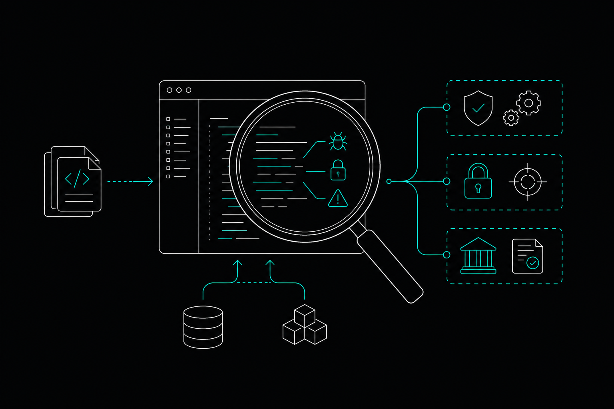

# Static Analysis Tools: 8 Best for Catching Bugs Early

Eight static analysis tools are worth a look for catching bugs early: SonarQube, Semgrep, CodeQL, Snyk, Qodana, Checkmarx One, Veracode and Aikido. They are grouped by use case, not ranked. Pick by language support, CI/CD and IDE integration, and how well each limits false positives. Pattern-based scanners suit fast feedback, while deep data-flow engines suit regulated, enterprise codebases.

Static analysis reads your code without running it. That makes it the earliest automated check you can add. Adoption still lags, and noisy results are a common reason teams switch scanners off.

## What Are SAST and SCA Tools, and Why Use Them?

SAST (static application security testing) tools scan the code your team writes, looking for bugs and vulnerabilities before the program runs. In security work, static analysis means inspecting source code, or compiled binaries, for flaws without executing anything. The scanner reads the code, builds a model of how it is structured, and flags patterns that match known weaknesses or quality problems.

SCA (software composition analysis) tools scan something different: the open-source packages your project depends on. They match those packages against known vulnerabilities. You need both, because your own code and your dependencies fail in different ways.

A flaw in your own logic needs a code fix from your team. A flaw in a dependency usually needs an upgrade, a patch or a replacement package. Treating the two as one pile of alerts makes triage slower, so it helps to know which kind of finding you are looking at before you assign it.

Dependency risk is common. Research from 2024 indicates that 84% of codebases have at least one vulnerability in their open-source dependencies, according to [Decryption Digest's 2026 guide](https://www.decryptiondigest.com/blog/guide-finding-best-application-security-testing-tools).

Adoption of SAST is uneven. A 2024 study from Lancaster University, published via ACM, found that only 20% of its pre-screened developers actually use SAST tools. In cloud-native security, a 2024 Linux Foundation report found that 63% of organizations use SAST tools. The two figures measure different groups, so read them as a spread, not a contradiction.

## Static Analysis Tools at a Glance

This table compares all eight tools on primary focus, where each runs, and what pricing is public. Most of these vendors do not publish prices, and Snyk is the one with a paid plan. Industry use is real: a 2026 Perforce report, which is vendor-reported, says 55% of automotive software teams use static analysis and SAST tools.

| Tool | Primary focus | Where it runs | Pricing |
|---|---|---|---|
| SonarQube | Bugs, vulnerabilities and technical debt across 30+ languages | Cloud | Not publicly listed |
| Qodana | JetBrains IDE inspections in CI/CD | Not stated | Not publicly listed |
| Semgrep | Fast pattern matching and custom rules | Not stated | Not publicly listed |
| Snyk | SAST, SCA, container and IaC scanning | Cloud | Paid plan |
| CodeQL | Querying code as data for complex security patterns | Not stated | Not publicly listed |
| Aikido | SAST, SCA, DAST and secrets in one dashboard | Cloud | Not publicly listed |
| Checkmarx One | Deep data-flow SAST, SCA and supply chain security | Cloud | Not publicly listed |
| Veracode | Binary and pipeline scanning for policy enforcement | Cloud | Not publicly listed |

## 1 to 3: SonarQube, Qodana and Semgrep for Everyday Code Quality

Three tools fit day-to-day checks in CI. Each entry covers what it does, where it fits, and what to watch. The order is not a ranking: these three are grouped because they focus on code quality and fast feedback more than on deep security research.

When you compare them, think about who will own the tool. A central dashboard suits a platform team, IDE-based inspections suit developers who live in one editor, and a rule-based scanner suits a team willing to write and maintain its own checks.

### 1. SonarQube

SonarQube analyzes code for bugs, vulnerabilities and technical debt across 30+ programming languages. It runs in the cloud.

- **Best for:** teams that want one central dashboard for quality and governance.
- **Watch for:** pricing is typically based on lines of code, and the dashboard can feel external to daily developer workflows. Its remediation time estimates may also be inaccurate or overestimated.

### 2. Qodana

Qodana brings JetBrains IDE inspection logic into CI/CD pipelines to flag quality and security issues.

- **Best for:** teams already working in JetBrains IDEs. It extends the inspections developers see locally to the whole team's workflow.
- **Watch for:** pricing is not publicly listed.

### 3. Semgrep

Semgrep is a fast, lightweight scanner that uses pattern matching for security, quality and custom rule enforcement.

- **Best for:** teams that want to write their own rules quickly.
- **Watch for:** the best results need a team member who actively maintains and evolves the rules. Pricing is not publicly listed.

## 4 to 6: Snyk, CodeQL and Aikido for Security-First Teams

Three tools put security findings and dependency risk first. Most vendors here keep pricing private, so expect to ask for a quote. Snyk is the exception: it has a paid plan.

These are also grouped by focus, not ranked. What separates them is how each handles noise: reachability analysis, custom queries, or a single dashboard that merges several scanners into one list.

### 4. Snyk

Snyk covers SAST (Snyk Code), SCA (Snyk Open Source), container and Infrastructure-as-Code scanning in one platform. It runs in the cloud.

- **Best for:** teams that want fast, IDE-native feedback on both their own code and their dependencies.
- **Watch for:** it offers reachability analysis, which flags only dependency vulnerabilities your code actually reaches. That cuts false positive alerts in dependencies. The paid plan carries the full feature set.

### 5. CodeQL

CodeQL treats code as data. You query it with a specialized language to find complex security patterns. It is the main analysis engine behind GitHub Advanced Security.

- **Best for:** teams on GitHub that want deep, custom security queries.
- **Watch for:** highly custom queries need real expertise to write. Pricing is not publicly listed.

### 6. Aikido

Aikido pulls several scanners (SAST, SCA, DAST and secrets) into a single developer-friendly dashboard. It runs in the cloud.

- **Best for:** startups and mid-market teams that want low noise and quick onboarding.
- **Watch for:** pricing is not publicly listed.

A caveat on false positives. Teams report a 78% false positive rate with legacy SAST tools, and many deprioritize security findings as a result, per Decryption Digest's 2026 guide. That figure describes legacy tools, not every scanner on this list.

## 7 and 8: Checkmarx One and Veracode for Enterprise Compliance

Two tools suit large, regulated organizations. Vendors rarely publish scan speeds or on-premise hardware requirements, so none appear here. Ask for both during evaluation, and test on your largest repository.

In regulated settings, the scanner is only part of the job. You also need policy enforcement, audit trails and coverage for the languages and frameworks your teams already ship. Weigh those needs against the setup effort, since both tools are built for scale and can be heavy for a small team.

### 7. Checkmarx One

Checkmarx One is an enterprise platform for deep data-flow SAST, SCA and software supply chain security. It runs in the cloud.

- **Best for:** large teams that need the widest language coverage. It supports 35+ frameworks.
- **Watch for:** the complexity may be excessive for smaller teams. Pricing is not publicly listed.

### 8. Veracode

Veracode runs static analysis through binary scanning and pipeline scanning for policy enforcement. It runs in the cloud.

- **Best for:** organizations that need to scan compiled binaries, not just source code. It also offers Phylum-powered behavioral analysis for SCA.
- **Watch for:** pricing is not publicly listed.

Both tools sit in a market where static analysis is routine. A 2026 Perforce report, which is vendor-reported, puts use at 55% of automotive software teams. A 2024 Linux Foundation report found 63% of organizations use SAST for cloud-native security.

## How Does Static Code Analysis Work Compared with Dynamic Analysis?

Pattern-based tools stay close to the code's structure, while deep engines follow data flow and track untrusted input (taint analysis) from entry point to risky use.

Dynamic analysis differs in one way: it runs the program. DAST (dynamic application security testing) probes a running application from the outside. Static analysis reads code that never executes, so it works before a build exists. Dynamic analysis finds problems that only appear at runtime.

That difference shapes when each one fits. Static checks belong on every commit and pull request, where a finding points to a specific line and is cheap to fix. Dynamic checks belong later, against a staging or test environment, where they can catch configuration and runtime behavior that source code alone does not show.

The two catch different flaws, which is why Aikido bundles both kinds of scanning.

## When Findings Need Context: Checking Blast Radius Before You Fix

A scanner tells you what is wrong. It does not tell you what breaks when you fix it. Triage stalls in that gap.

The usual result is a long backlog of findings that nobody wants to touch. Developers hesitate to change code when they cannot see who calls it or which tests protect it. Knowing the surrounding context turns a vague warning into a decision you can make quickly.

[Memtrace](https://memtrace.io/) is a code graph tool that maps functions, callers, APIs and tests for developers who need context around a finding. It builds a local graph that connects them across your repository. Query it before the next edit to see the blast radius of a flagged line, trace the execution path that reaches it, and find the tests that cover it. A finding with no callers and no tests reads differently from one inside a hot path.

Memtrace is not a scanner. It adds context to what your scanner reports.

Use this checklist when choosing a tool:

1. Confirm it supports your languages and frameworks.
2. Check for IDE and CI/CD integration where your team works.
3. Test it on your largest repository and ask the vendor for scan speed.
4. Look for noise controls such as reachability analysis.
5. Ask for pricing, since most vendors do not publish it.

Prices and plan limits verified as of November 2026.

## FAQs

### What is static analysis in cyber security?

Static analysis in cyber security means inspecting source code, or compiled binaries, for vulnerabilities without running the program. Scanners look for insecure patterns, unsafe data flows and known weaknesses. Because nothing executes, you can run it early, on every commit, before a build or test environment exists.

### What's the difference between static and dynamic analysis?

Static analysis reads code without running it, so it works before a build exists and points to specific lines. Dynamic analysis, such as DAST, tests a running application from the outside. It finds problems that only appear at runtime. Most teams use both, since each catches flaws the other misses.

### Do static analysis tools replace code review?

No. Scanners catch known patterns fast and consistently, but they cannot judge intent, design or business logic. Reviewers can. Treat the scanner as a first pass so human review can focus on design and intent.

### How do I reduce false positives from a SAST tool?

Start with tools that filter by relevance, such as reachability analysis for dependencies. Tune or write rules for your codebase, and assign someone to maintain them. Then check each finding's callers and test coverage before you act. Legacy tools drew a reported 78% false positive rate, so tuning matters.

### Can static analysis tools run in an IDE as well as in CI/CD?

Yes, several can. Qodana extends JetBrains IDE inspections into CI/CD pipelines, and Snyk is known for fast, IDE-native feedback. Running in both places gives you quick feedback while you write and a gate before code merges. Check each tool's current plugin support before you commit.

### Are free or open-source static analysis tools good enough for a small team?

Often, yes. Semgrep suits small teams that want custom rules, though it needs someone to maintain them. Vendors rarely publish pricing, so confirm what each free tier includes. A small team should weigh rule upkeep time against the cost of a paid plan.

## Conclusion

The right static analysis tool depends on your languages, where you want feedback, and how much noise your team will tolerate. Pattern-based scanners give fast results, and deep data-flow engines fit regulated codebases. Whichever you pick, the scanner flags the issue and you still decide what is safe to change.

Start by running two candidates on your largest repository and compare how many findings you would act on. Then check the callers and tests around the top few findings before you fix them.